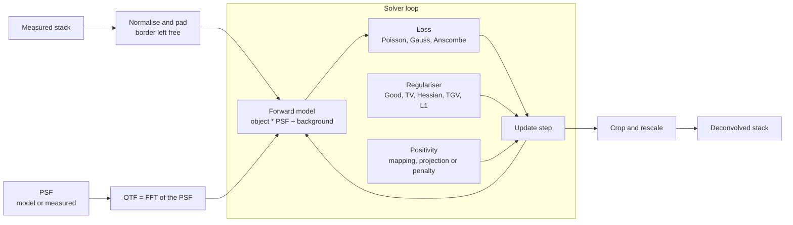
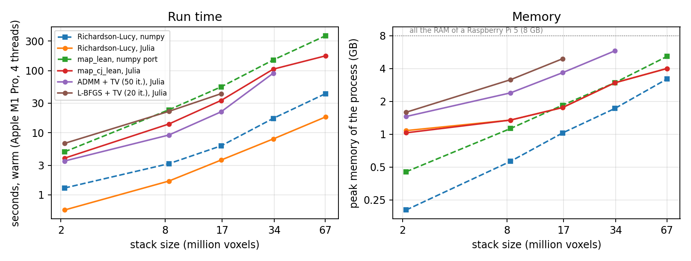
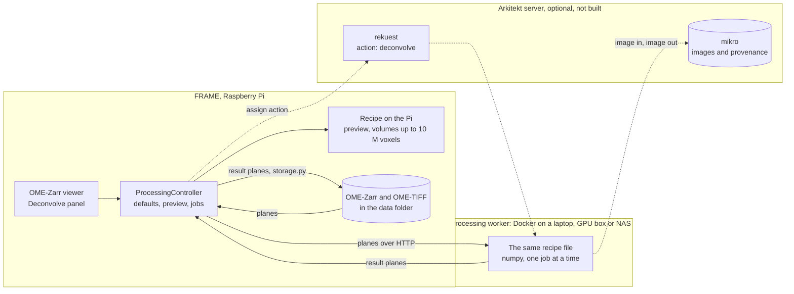
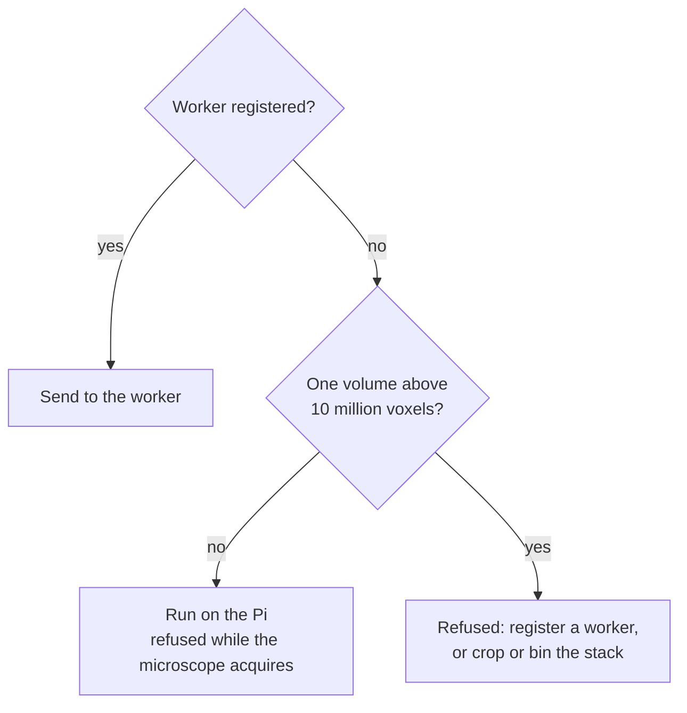
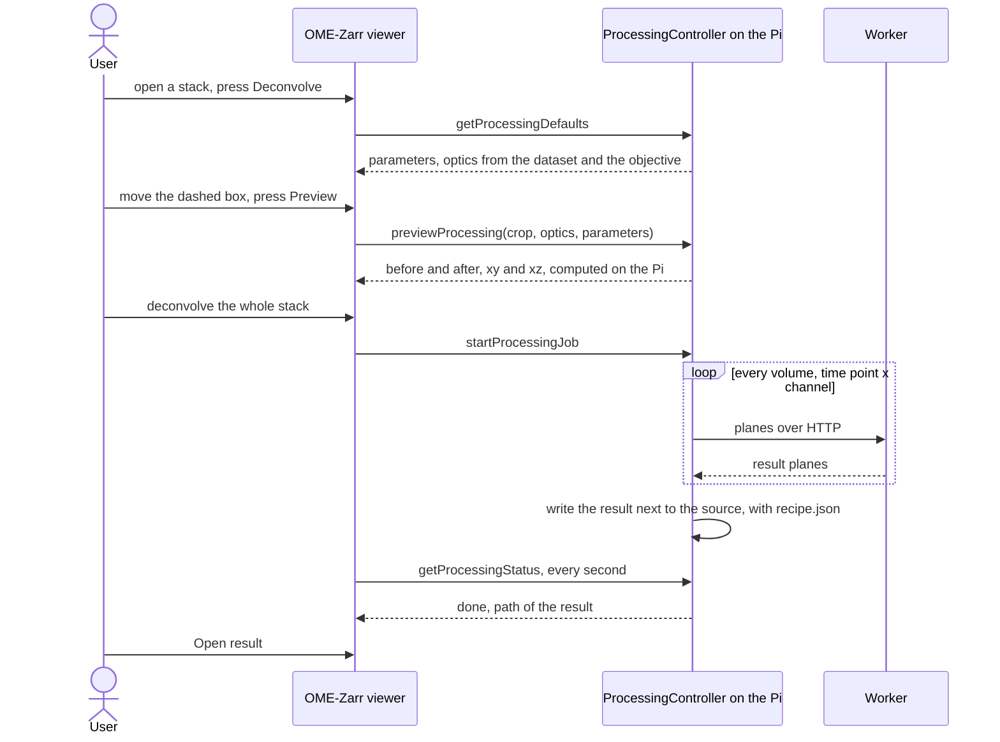

# 3D deconvolution for FRAME: DeconvOptim.jl, where to run it, what to build around it

Status 2026-11-22. Sections 2–4 are the exploration: what the `new_methods` branch of
[DeconvOptim.jl](https://github.com/beniroquai/DeconvOptim.jl/tree/new_methods) can do, how fast it
is, whether to keep it in Julia or port it. Sections 5–6 say where it runs and what the button does,
and DEC-1 to DEC-3 of section 8 are built: the numpy recipe in ImSwitch, the "Deconvolve" panel with
a preview in the OME-Zarr viewer, and a processing worker container. None of it uses Julia; Julia
stays the reference the tests compare with. Laptop timings are from one Apple M1 Pro; one stack
size was also run on a Raspberry Pi. **Everything ran on synthetic stacks and the virtual
microscope; nothing on real FRAME data.**

## 1. In short

- **The package is a full deconvolution toolbox**, and the branch adds a lot: three conjugate-gradient
  MAP solvers, ADMM, Chambolle–Pock, TGV and L1 regularisers, a per-pixel noise model and padding per axis.
- **It works and it is fast enough.** A 32 × 512 × 512 stack takes 14 s with the new `map_cj_lean`
  solver (4 CPU threads); a 64 × 1024 × 1024 stack takes 3 min and 4 GB.
- **Port one solver to Python, keep Julia as the reference.** A numpy port of `map_cj_lean`
  (now `imswitch/imcontrol/model/aufgaben/deconvolution.py`, with the PSF models, no new dependency)
  gives the same result (correlation 0.99–0.9995 with the Julia output) and is 1.3–2.1 times
  slower. Rust would not be faster: the time goes into FFTs, which are native code already.
- **Raspberry Pi: light version only.** Measured: 18 s for the MAP solver on 32 × 256 × 256, 3.7
  times the laptop's time, the same result. Preview on a crop and small stacks (up to about
  32 × 512 × 512) fit. Larger stacks belong on a worker: a Docker container on a laptop, GPU box or NAS.
- **Arkitekt + mikro is the second way to reach the same worker**, for labs that run an Arkitekt
  server. The worker should not depend on it.
- **The button** is built: "Deconvolve" in the OME-Zarr viewer. It reads the optics from the
  dataset and the objective, shows a before/after preview on a crop (on the Pi), then runs the whole
  stack as a job on the worker (or the Pi) and stores the result next to the original.
- **Cheapest next wins**: flat-field correction, haze removal, full focus from a z-stack, a measured
  PSF from beads. Section 7 lists these and the advanced ones.

## 2. What DeconvOptim.jl does

DeconvOptim.jl (F. Wechsler, R. Heintzmann, [JuliaCon Proceedings 2023](https://doi.org/10.21105/jcon.00099),
MIT licence) treats deconvolution as an optimisation problem: find the non-negative object whose
blurred version explains the data best, under a noise model and a smoothness prior.



### Building blocks

| Block | Choices (**bold** = new on `new_methods`) |
|---|---|
| Noise model | `Poisson`, `Gauss`, `ScaledGauss`, `Anscombe`, **`WeightedGauss`** (one weight per pixel, e.g. an sCMOS noise map) |
| Regulariser | `Tikhonov` (three modes), `GR` (Good's roughness), `TV`, `TH` (total Hessian), `HS` (Hessian–Schatten), **`L1`** (sparsity), **`TGV`** (no staircasing) |
| Positivity | mappings `Non_negative` (x²), `Map_0_1`, `Piecewise_positive`, **`Pow4_positive`**, **`Abs_positive`**, **`Continuously_positive`**; **`Positivity`** penalty; exact projection in ADMM / Chambolle–Pock |
| Borders | **padding per axis**, e.g. `(0.05, 0.05, 0.25)`: the border is not constrained by the data, which removes FFT wrap-around. A wide-field stack needs it along z |
| Forward model | convolution over chosen dimensions; `invert` accepts any differentiable forward model |
| Hardware | CPU (FFTW, threads); NVIDIA GPU through CUDA.jl; the new solvers use KernelAbstractions kernels on the array's backend |
| Not included | a 3D PSF model (`generate_psf` is a 2D approximation), file I/O, tiling for stacks larger than memory, deskew, blind (PSF-estimating) deconvolution |

### Solvers

The branch (20 commits, 13 October to 17 November 2026, +4,700 lines) adds five solvers that need
no automatic differentiation.

| Solver | Call | Idea | Per iteration | Notes |
|---|---|---|---|---|
| L-BFGS | `deconvolution(...)` | automatic differentiation (Zygote) + Optim.jl | several convolutions, history arrays | most flexible: every loss, regulariser and custom forward model; most memory |
| Richardson–Lucy | `richardson_lucy_iterative` | multiplicative update | 2 convolutions | simple, slow to converge |
| **MAP-CG** | `map_cj` | object = x², conjugate gradients, analytic Newton line search | 3 convolutions | Poisson or Anscombe; Good or Hessian penalty; saddle escape for voxels stuck at zero |
| **MAP-CG lean** | `map_cj_lean` | same, one Newton step + backtracking, stencils computed on the fly | 3 convolutions, **5 arrays** | adds Gauss loss, per-pixel noise weights, a strictly positive mapping. The one to port |
| **MAP-CG exact** | `map_cj_exact` | exact line search after Verveer and Jovin (MAPGR / MAPPR); closed form for Gauss + Good | 3 convolutions, 6 arrays | fewest iterations per result |
| **ADMM** | `opt=ADMM()` | splitting; every sub-step solved exactly, linear step is one division in Fourier space | about 2 convolutions + proximal steps | exact TV / TH / HS / L1, exact positivity, result depends on λ rather than on the iteration count |
| **Chambolle–Pock** | `opt=ChambollePock()` | primal–dual, no linear solve | same | everything ADMM has, plus `TGV` |

### Wide field and light sheet

The solver is the same; only the PSF changes.

| Modality | PSF | What to watch |
|---|---|---|
| Wide field | detection PSF from NA, wavelength, immersion, pixel size and z step | out-of-focus light leaves the stack: pad along z. The missing cone limits how much axial resolution comes back |
| Light sheet | detection PSF × sheet profile (thickness along z) | much better conditioned, converges in few iterations. The sheet thickens away from its waist; a single PSF ignores that |
| Oblique plane (OPM) | as light sheet, in the deskewed frame | deskew first (`OPMController` has it), or shear the PSF and deconvolve the raw stack |

## 3. What it does on a laptop

Test object: beads, filaments, a hollow shell and line pairs; simulated as a 20x / 0.75 wide-field
stack (0.12 µm pixels, 0.5 µm planes, peak 300 photons, background 5), Poisson noise.
"Correlation" is the normalised cross-correlation with the object (measured stack: 0.22).


The same numpy solver on a light-sheet stack (10x / 0.3 detection, 4 µm sheet): correlation 0.40
before, 0.97 after, 4 s.


### Run time and memory

Warm run, 4 threads, float32, padding 25 % along z. Iterations: Richardson–Lucy and MAP-CG 30,
ADMM 50, L-BFGS 20. Each cell: seconds · peak memory of the process.

| Stack (z × y × x) | Mvoxel | Richardson–Lucy, numpy | Richardson–Lucy, Julia ¹ | `map_lean`, numpy port | `map_cj_lean`, Julia | ADMM + TV, Julia | L-BFGS + TV, Julia |
|---|---|---|---|---|---|---|---|
| 32 × 256 × 256 | 2.1 | 1.3 s · 0.2 GB | 0.6 s | 4.9 s · 0.5 GB | 3.9 s · 1.0 GB | 3.5 s · 1.5 GB | 6.8 s · 1.6 GB |
| 32 × 512 × 512 | 8.4 | 3.2 s · 0.6 GB | 1.7 s | 23.4 s · 1.1 GB | 13.9 s · 1.3 GB | 9.2 s · 2.4 GB | 22.1 s · 3.2 GB |
| 64 × 512 × 512 | 16.8 | 6.2 s · 1.0 GB | 3.6 s | 54.9 s · 1.9 GB | 33.2 s · 1.8 GB | 21.8 s · 3.7 GB | 42.6 s · 4.9 GB |
| 32 × 1024 × 1024 | 33.6 | 17.1 s · 1.7 GB | 8.0 s | 149 s · 3.0 GB | 106 s · 3.0 GB | 91.3 s · 5.8 GB | not run |
| 64 × 1024 × 1024 | 67.1 | 42.7 s · 3.2 GB | 18.0 s | 366 s · 5.2 GB | 174 s · 4.0 GB | not run | not run |

¹ Julia's Richardson–Lucy has no padding and no background, so its grid is a third smaller. Julia
memory is the peak of one process that ran `map_cj_lean`, Richardson–Lucy, ADMM and L-BFGS in that
order, so Richardson–Lucy has no number of its own.



### Quality at equal effort (32 × 256 × 256)

| Solver | Iterations | Correlation | Time |
|---|---|---|---|
| Richardson–Lucy (numpy) | 30 / 100 / 300 | 0.54 / 0.81 / 0.94 | 1.3 s / ≈ 4 s / ≈ 13 s ² |
| `map_cj_lean` (Julia) | 30 | 0.93 | 3.9 s |
| `map_lean` (numpy port) | 30 / 100 | 0.90 / 0.97 | 4.9 s / ≈ 16 s ² |
| `map_cj_exact`, `map_cj` (Julia) | 30 | 0.95 | not timed warm |
| L-BFGS + TV, λ = 10⁻⁴ (Julia) | 20 / 60 | 0.87 / 0.98 | 6.7 s / 17 s |
| ADMM + TV (Julia) | 50 / 200 / 1000 | 0.27 / 0.34 / 0.49 | 3.5 s / ≈ 9 s / not timed |
| Chambolle–Pock + TV (Julia) | 300 | 0.28 | not timed |

² Scaled from the time for 30 iterations; the correlation was measured.


What the numbers say:

- **Conjugate gradients beat Richardson–Lucy by about ten times in iterations.** 30 MAP-CG
  iterations do what 300 Richardson–Lucy iterations do.
- **The numpy port matches Julia.** Its output correlates 0.990–0.9995 with Julia's `map_cj_lean`
  on all five stacks. It is 1.3–2.1 times slower and uses about the same memory. It is not optimised.
- **`map_cj_lean` needs the least memory** of the regularised solvers: about 40 % of L-BFGS and half of ADMM.
- **ADMM and Chambolle–Pock were slow on this object** (sparse, high dynamic range), with and
  without regulariser, background or padding. A smaller fixed penalty helped (ρ = 0.01: 0.46 after
  200 iterations). Their documentation reports fast convergence on its own test, so this is worth
  reporting upstream; the benchmark files reproduce it. Timings above are per iteration count, not
  per quality.
- **Regularisation weights are data dependent.** The test object wanted almost none (Good's
  roughness γ = 10⁻⁴, TV λ = 10⁻⁴). Real, dense samples will want more. The UI needs a preview.

### What Julia costs to deploy

| Step | Measured (M1 Pro) |
|---|---|
| Install and precompile the 185 dependencies | 140 s, 1.4 GB peak memory, 633 MB on disk |
| Load the package in a fresh process | 2.2 s |
| First call of a solver (compilation) on top of the warm time | about 5 s (`map_cj_lean`), 7–22 s (ADMM), 1–20 s (L-BFGS) |

So Julia wants a long-lived warm process. A fresh process per job pays the compile time each
time. GitHub issue #125 reports the same need ("a button to warm up the Julia core"), and that an
earlier Julia GUI ran on a Raspberry Pi 4B; it also gives 2–3 min on a laptop CPU and 10–20 s on an
RTX 3060 for a 128 × 512 × 512 stack with the older solver.

## 4. Julia, Python or Rust

| Option | Work | Speed | Deployment | Verdict |
|---|---|---|---|---|
| **Julia as it is**, in a container, called from Python (`juliacall`) or over HTTP | none on the algorithms | fastest on CPU; NVIDIA GPU through CUDA.jl | 0.6 GB of packages plus the runtime, compile time on first use, a warm process to keep alive | on the worker: yes, as the full-feature backend. In the ImSwitch process on the Pi: no |
| **numpy / scipy port of one solver** (`map_cj_lean` + Richardson–Lucy) | prototype exists, 200 lines | 1.3–2.1 times slower than Julia | nothing new: numpy and scipy are ImSwitch dependencies | default on Pi and worker |
| Same code on CuPy or PyTorch | swap the array module | GPU on the worker | one optional dependency on the worker | later, when a GPU worker exists |
| **Rust** | weeks: FFT, stencils, line search, Python bindings | no gain: FFT-bound, and FFTW / pocketfft are native already | one static binary; could compile to WebAssembly / WebGPU | not now. Only if the browser runner of the facility roadmap needs it |

Keep the Julia package as the reference: the port is tested against its output on the benchmark
stacks. New solvers land in Julia first and get ported only when they prove useful.

## 5. Where it should run

A Raspberry Pi 5 has four Cortex-A76 cores, up to 8 GB of RAM shared with ImSwitch and the camera
buffers, and no GPU that runs FFTs. Measured on a Raspberry Pi (2026-11-22, `benchmark.py run`,
4 threads, 32 × 256 × 256): Richardson–Lucy 5.5 s, MAP 18.2 s, with the laptop's correlations to
four digits. That is 3.7–4.3 times the laptop's time, better than the 5–10 times estimated before.
The larger rows are the laptop times scaled by 3.7 (≈) until they are run on the Pi. ImSwitch runs a
volume on the Pi up to 10 M voxels (`PI_MAX_VOXELS`), and never while the microscope acquires.

| Stack | numpy port on the laptop | Raspberry Pi | Verdict for the Pi |
|---|---|---|---|
| crop 32 × 256 × 256 | 5 s · 0.5 GB | 18 s, measured | yes: this is the preview |
| 32 × 512 × 512 | 23 s · 1.1 GB | ≈ 1.5 min | yes, when no scan is running |
| 64 × 512 × 512 | 55 s · 1.9 GB | ≈ 3.5 min | no: above 10 M voxels |
| 32 × 1024 × 1024 | 2.5 min · 3.0 GB | ≈ 9 min | no |
| 64 × 1024 × 1024 | 6 min · 5.2 GB | ≈ 23 min | no |
| full sensor, 32 × 2048 × 3072 | not run; about 15 GB in one piece, about 2 GB in 512-pixel tiles | – | no; the worker, in tiles |





- **One recipe, several runners.** This is the "one recipe, three runners" plan of
  `FRAME_FACILITY_ROADMAP.md` part B with deconvolution as its first heavy recipe: a pure function
  from a stack and typed parameters to a stack, no ImSwitch imports. In newswitch the recipe becomes
  an action and the worker a sidecar or a remote Arkitekt app (`NEWSWITCH_PLUGIN_ARCHITECTURE.md`).
- **Plain HTTP worker, and the Pi pushes.** A stand-alone FRAME plus a laptop needs no server. The
  Pi reads the planes (OME-Zarr or OME-TIFF), sends them as it reads them, and writes the result
  planes as they come back. The worker never connects to the microscope: no route back to the Pi,
  no certificates, no zarr or codecs in the container, and `storage.py` stays the only writer. The
  Pi never holds more than one plane of a worker job. (Planned first: the worker reads the chunks
  from `/data` itself; dropped for these reasons.)
- **Arkitekt as a second door.** ImSwitch already uploads images to mikro and declares actions
  (`ArkitektController`). The same worker registers a `deconvolve` action; the result is a new mikro
  image linked to the original. An earlier Arkitekt integration called a remote deconvolution after
  a snap; the call is still in `RecordingController.snapImageToPath`, commented out.
- **No Julia in it.** A Julia backend on the worker, behind the same recipe signature
  (`run(stack, spec, progress)`), stays possible for the solvers that are not ported (TGV,
  Hessian–Schatten, weighted noise). It was left out on purpose.

## 6. The button



| Piece | Proposal |
|---|---|
| Where | Built: "Deconvolve" in the header of the OME-Zarr viewer (`VizarrViewer`), panel `omezarr/DeconvolutionPanel.jsx`. Not in Live View: deconvolution works on stored stacks. The light-sheet app is not wired yet |
| Presets | Built: NA from the dataset or else the current objective, pixel size and z step from the dataset, emission wavelength from the channel name, immersion index from the NA, modality (wide field, light sheet + sheet thickness). All editable; the panel says where each came from |
| Parameters shown | method (Regularised MAP, Richardson–Lucy), iterations, regularisation (one log slider), background (empty: estimated; the preview shows the estimate). Padding is fixed (25 % along z), tiles default to 512 px |
| Preview | the dashed box in the middle of the view: 128, 256 or 512 px and up to 64 planes (at most 4.2 M voxels), on the Pi. Before/after toggle, xy plane and xz section at the true aspect. 5.6 s for 256 × 256 × 32 on the laptop |
| Job | one at a time, cancellable (the unfinished result is removed), refused on the Pi while the microscope acquires (`controller/busy.py`; acquisitions are refused while the Pi deconvolves); progress per volume, no current-iterate preview |
| Result | `<source>_deconvolved.ome.zarr` next to the source through `model/aufgaben/storage.py`: float32, the source's pixel size, z step and channel names, a display window from the data, and `recipe.json` inside it (recipe, version, the request, runner, time). The request is the body of `startProcessingJob`, so it reruns the job |
| API | `getProcessingDefaults`, `previewProcessing` (POST), `startProcessingJob` (POST), `getProcessingStatus`, `cancelProcessingJob`, `getProcessingWorker`, `setProcessingWorker` (`ProcessingController`, AGENTS.md §4.10). The panel is written for this one recipe; one built from the recipe's schema is DEC-5 |

### The processing worker

```bash
docker build -f docker/processing-worker/Dockerfile -t imswitch-processing-worker imswitch/imcontrol/model/aufgaben
docker run --rm -p 8090:8090 imswitch-processing-worker
```

Without Docker, on any computer with numpy and scipy:
`python imswitch/imcontrol/model/aufgaben/worker.py --port 8090`. Then in the viewer's Deconvolve
panel, Worker URL `http://<that computer>:8090`, Save (stored in the setup as
`processing.workerUrl`). The image is 365 MB: Python, numpy, scipy and two files. The protocol is in
the docstring of `worker.py`: POST a volume, poll the job, GET the result, DELETE it.

Tried on the laptop (2026-11-22): the worker in Docker Desktop (a Linux VM with 4 CPUs and 8 GB),
ImSwitch on the virtual microscope, the job started from the Deconvolve panel. A 64 × 1024 × 1024
uint16 stack, MAP with 30 iterations, 2 × 2 tiles of 512 px: 638 s from start to the written
result, 3.6 GB peak in the worker. ImSwitch used 0.57 of a CPU core during the job and 0.58
before it (the virtual camera's live stream), so reading the planes and writing the result do not
show. The first attempt without tiles needed about 6 GB, swapped in the 8 GB VM and took 218 s
per iteration instead of 12 s; hence the 512 px default. Cancel takes effect at the end of the
current iteration.

The optics matter more than the runner. The panel took NA 0.5 from the virtual objective while the
stack was simulated at NA 0.75: correlation with the object 0.21 → 0.54. With NA 0.75 the same
crop reaches 0.76. ImSwitch's writers do not store the objective NA with a dataset yet, so the
default comes from the objective in use now; the panel says so.

## 7. Beyond deconvolution

What commercial systems offer (names as marketed) and the open route with UC2 hardware.

| Users get elsewhere | Sold as | Open route | Effort | Runs on |
|---|---|---|---|---|
| Flat-field / shading correction | every vendor | calibration flat field (board row QCAL-flatfield) or a BaSiC-type estimate from the scan | low | Pi |
| Haze removal for wide field | Leica THUNDER (Computational Clearing), Keyence Haze Reduction | subtract a background estimated at a feature scale; live and 2D. The rigorous version is 3D deconvolution | low | Pi, live |
| Full focus / extended depth of field | Keyence Full Focus, Nikon EDF, Zeiss | sharpest plane per pixel from a z-stack (`focus_value` exists) | low | Pi, while the stack is taken |
| 3D deconvolution | Zeiss ZEN, Nikon NIS-Elements, Evident TruSight, Andor ClearView-GPU, Huygens, Microvolution | this document | medium | worker; preview on the Pi |
| Measured PSF | Huygens PSF Distiller | average bead images from a bead slide (QCAL-psf) | medium | worker |
| Resolution and quality number | few | image decorrelation or FRC: a stop criterion for the iterations and a QC value per run | low | Pi or worker |
| Denoising | Nikon Denoise.ai, camera-side filters | Noise2Void / CARE models exported to ONNX; non-local means as the classical fallback | medium | worker or browser |
| AI deblurring and restoration | Nikon Clarify.ai and Enhance.ai, Zeiss, Leica Aivia, Evident TruAI | CARE with training pairs the FRAME can record itself (short and long exposure, 4x and 20x of the same field) | advanced | worker with GPU |
| Optical sectioning by structured light | Zeiss Apotome, Keyence Sectioning | DMD / SLM patterns with three-phase or HiLo reconstruction (`SLMController`, PR #179) | medium | Pi or worker |
| Fluctuation super-resolution | Andor SRRF-Stream+ | eSRRF or MSSR on a fast series (NanoPyx is Python) | medium | worker |
| Pixel reassignment, joint deconvolution | Zeiss Airyscan Joint Deconvolution | image-scanning microscopy with the galvo and a camera, multi-view deconvolution | advanced | worker |
| Light sheet: deskew, deconvolve, fuse | Zeiss Lattice Lightsheet 7, Leica | deskew (`OPMController`), deconvolve with the sheet PSF, fuse with multiview-stitcher | medium | worker |
| Label-free contrast | specialised vendors | DPC is in ImSwitch; Fourier ptychography with the LED matrix resolves beyond the objective NA and is the UC2-specific one | advanced | worker |
| Processing during acquisition | Zeiss Direct Processing | an Aufgaben step hands each finished stack to the runner | medium | worker |

Existing open implementations to compare against or reuse instead of writing: scikit-image
`richardson_lucy` (already installed), RedLionfish (Richardson–Lucy on OpenCL, block-wise),
pycudadecon (CUDA, with deskew), `psfmodels` (Gibson–Lanni and vectorial PSFs), PointSpreadFunctions.jl.

## 8. Work packages

Not on the roadmap board yet. Sizes: S up to 2 days, M up to 2 weeks.

| ID | What | Done when | Size · status |
|---|---|---|---|
| DEC-0 | Run `scripts/deconvolution/benchmark.py` on a Pi 5, and on one real FRAME stack with beads | the estimate column of section 5 is replaced by numbers | S · **partly**: 32 × 256 × 256 on a Pi; the larger sizes and a bead stack are open |
| DEC-1 | Recipe: move the numpy solvers into a module without ImSwitch imports, PSF from optics metadata, test against stored Julia outputs | `deconvolve(stack, optics, parameters)` passes the comparison test | S · **done**: `model/aufgaben/deconvolution.py`, `test_deconvolution.py` (0.995 / 0.996 with Julia's projections), tiles |
| DEC-2 | Preview endpoint on the Pi and the crop + before/after view | a user finds the regularisation weight on a crop without leaving the viewer | M · **done**: `previewProcessing`, Deconvolve panel; laptop and virtual microscope only |
| DEC-3 | Worker container: recipe core, job API; the Pi sends the planes and writes the result; optional Julia backend with a warm process | a 64 × 1024 × 1024 stack is deconvolved from the UI with the Pi idle | M · **done** without the Julia backend: `worker.py`, `docker/processing-worker`, `startProcessingJob`; tried with Docker on the laptop |
| DEC-4 | Arkitekt app around the worker: `deconvolve` action on mikro images | the action shows in the Arkitekt UI and returns a linked image | S |
| DEC-5 | Process panel built from the recipe schema; job list; `recipe.json` | a second recipe (flat field) appears without UI work | M |
| DEC-6 | PSF: theoretical per objective and channel; measured from beads | deconvolution with the measured PSF beats the theoretical one on a bead slide | M |
| DEC-7 | Light sheet: sheet thickness in the PSF, deskew for OPM stacks | the virtual light-sheet volume deconvolves end to end | M |
| DEC-8 | GPU on the worker (CuPy / PyTorch backend, or CUDA.jl) | the full-sensor stack runs in minutes | S |

Order: DEC-0 → DEC-1 → DEC-2 → DEC-3 → DEC-5 → DEC-6, then DEC-4, DEC-7, DEC-8 as needed.

## 9. Risks and open points

- **The PSF decides the result.** FRAME's tube lens is unknown in detail, objectives corrected for
  0.17 mm cover glass are used through 1 mm plastic, and the field is not fully lit in the corners.
  A theoretical PSF will be optimistic; a measured one (DEC-6) is the fix.
- **Wide-field stacks have a missing cone.** Deconvolution removes haze and sharpens laterally; it
  does not turn a wide-field stack into a confocal one. Say so in the UI.
- **Quantitative use.** A regularised result is not linear in the object. Keep the raw data, store
  the parameters, and label deconvolved images as such.
- **Memory on the worker.** A full-sensor stack does not fit a laptop in one piece. The recipe tiles
  planes wider than 512 px, with an overlap from the PSF's reach over the stack depth; the tiled
  result correlates 0.995 with the whole-plane one. A tile still holds every plane, so a very deep
  stack needs a smaller tile or a GPU.
- **Pi numbers**: one size measured, the rest scaled from it (DEC-0).
- **Untested** on hardware, on real FRAME data, on float64 or int64 stacks, and with a worker
  on another computer: the worker ran in Docker on the same laptop as ImSwitch.
- **ADMM / Chambolle–Pock convergence** on sparse objects needs a look upstream before these
  solvers are offered in a UI.

## 10. How the numbers were made

| File | Purpose |
|---|---|
| `imswitch/imcontrol/model/aufgaben/deconvolution.py` | the recipe: PSF models, Richardson–Lucy, the `map_cj_lean` port, tiles, the synthetic test object (was `scripts/deconvolution/deconv_numpy.py`) |
| `imswitch/imcontrol/_test/unit/test_deconvolution.py` | the comparison with DeconvOptim.jl (stored projections in `deconvolution_julia_reference.npz`), tiles, PSF, refusals |
| `scripts/deconvolution/benchmark.py` | test stacks (`data`), numpy timings (`run`), table (`table`), figures (`figures`). On a Pi: copy it and `deconvolution.py` into one folder, `python3 -m venv .venv && .venv/bin/pip install numpy scipy`, then `data` and `run` per size; `run` reports peak memory on Linux too |
| `scripts/deconvolution/benchmark.jl` | DeconvOptim.jl on the same stacks; every solver twice (first call, warm) |

Machine: Apple M1 Pro, 16 GB, macOS; Julia 1.13.3; DeconvOptim.jl `new_methods` at `c72a2c8`;
numpy 2.1, scipy 1.16; 4 threads for FFTs and Julia.
