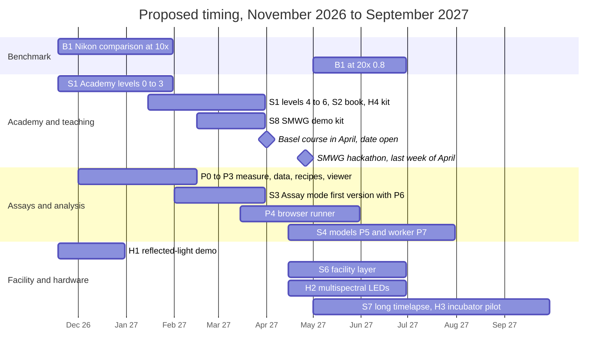
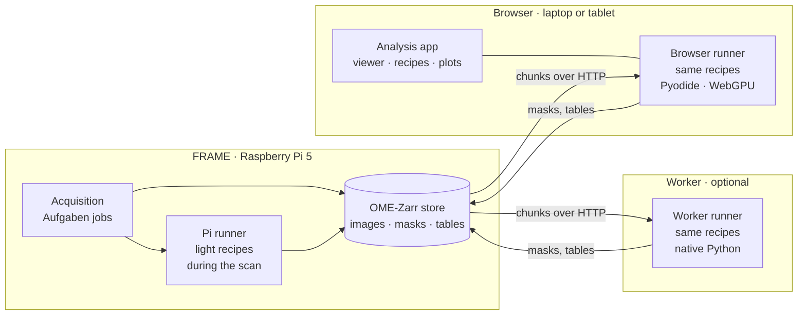
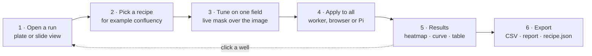

# FRAME for core facilities: workplan, and image analysis that does not load the Pi

*Status 2026-11-18. A plan, not a description of the software. Columns named "today" were checked
against the code (branch `feat/spectrometer`); everything else is a proposal. Inputs: feedback from a
core-facility manager (October 2026), the Nikon ECLIPSE Ji product page, the Keyence BZ-X1000 and
BZ-XLC1 catalogues (German editions, 2025) and a survey of image analysis in the browser (§B7).*

**In short**

- FRAME has the engine: jobs, scans, focus maps, OME-Zarr, a kiosk UI. ECLIPSE Ji and BZ-X win on the
  layer above it: assay presets, "set on one image, apply to all", plate heatmaps, reports.
- **Part A** lists what to build for facilities and first-time users. The largest lever is a UC2
  Academy that takes over part of the training load: the facility we talked to runs about 150
  trainings a year at 2–3 h each.
- **Part B** is how to offer analysis without loading the Pi: write each analysis once as a *recipe*
  and run it in one of three places: on the Pi during the scan, in the user's browser, or on a worker.
- Fixed date: **April 2027** (teaching course in Basel; Smart Microscopy Working Group (SMWG) meeting
  with a useq/OME-Zarr hackathon).

---

## Part A · Workplan

### A1. Gaps against Nikon ECLIPSE Ji and Keyence BZ-X1000

| What they sell | ECLIPSE Ji | BZ-X1000 | FRAME / ImSwitch today | Gap → package |
|---|---|---|---|---|
| Assay-first flow: load plate, pick assay, review, report | 6 standard + 11 optional assays | cell count, batch count and imaging-cytometer modules | Aufgaben jobs and macro buttons, wellplate UI, kiosk shell; no presets | Assay mode (S3) |
| Set on one image, apply to all; plate heatmap and charts | views per plate, well and cell | settings file applied to many images and plates; heatmap, click a well | none | S3, engine in Part B |
| Deep-learning segmentation | yes, also sets parameters | – | none | S4 |
| Plate recognition, alignment, empty-well skip, plate-wide exposure | yes | navigation scan finds the sample outline | labware, overview registration wizard, prescan, `regions_from_overview`, camera auto exposure | one auto-setup step (S5) |
| Stitching with shading correction, tilt and autofocus per tile | – | up to 50,000 × 50,000 px | stage-position mosaic, Ashlar registration, focus maps; no shading correction | flat-field in the stitch (P3) |
| Full focus, haze reduction, optical sectioning, 3D view, tracking | – | yes, as modules | Z-stacks, SIM controller; viewing and tracking in napari | recipes (P3), later |
| Time-lapse with incubation, focus tracking, curves over time | proliferation assay | chamber for temperature, CO2 and humidity | timelapse, autofocus, focus maps; no incubation, no live curve | S7, H3 |
| Reuse settings from a saved image, search images by settings, low-photobleach live mode | – | yes | OME metadata; the job is saved with each run | small UI items in S3 |
| Dark box on a normal bench | yes | yes | to check on FRAME | light-tight cover |
| Remote use | – | remote access | native: the UI is a web page | lead with it |
| Open interfaces | – | OME-TIFF export | REST, Jupyter, useq, OME-Zarr, SiLA 2, Arkitekt, virtual microscope | lead with it |

"–" means not mentioned in the source. Missing for facilities and in neither brochure: login, usage
logs for billing, training certificates, notifications, QC trends (S6).

### A2. Work packages

Size: S = weeks, M = one to two months, L = a quarter.

| WP | What | Builds on (today) | Size | When |
|---|---|---|---|---|
| **S1 Academy** | First-run onboarding and graded lessons with automatic checks, badges and a certificate; also on the virtual microscope | acceptance-test, objective and overview wizards; pixel and read-noise calibration; `?app=` deep links for QR codes; i18n | M | levels 0–3 Jan, all Mar 2027 |
| **S2 Jupyter Book** | The Academy levels as notebooks, on a virtual or a real FRAME | about 20 bundled notebooks (holography EN/DE, stitching, autofocus, focus map, DPC, useq MDA, smart microscopy); `imswitchclient` | M | Mar 2027 |
| **S3 Assay mode** | Four presets (count and confluency, % GFP-positive, live/dead, wound healing), one button on the kiosk, plate heatmap, CSV and report. Engine: Part B | Aufgaben, macro buttons, analysis steps, wellplate UI, mobile kiosk | L | first version Mar 2027 |
| **S4 Open segmentation** | Small StarDist / Cellpose models; model and parameters saved with the data (P5) | Aufgaben analysis steps, OME metadata | M | from Apr 2027 |
| **S5 Plate auto-setup** | Recognise the plate, align it, skip empty wells, one exposure per plate | overview registration, prescan, `regions_from_overview`, labware | M | Q2 2027 |
| **S6 Facility layer** | Login, data per user, usage log for booking and billing, certificate gate, notifications, QC trend | acceptance test, calibration wizards; no authentication today | L | Q2 2027 |
| **S7 Long timelapse** | One-week runs: resume after a restart, focus and drift per time point, alerts | Aufgaben, focus maps, disk-space warning | M | Q2–Q3 2027 |
| **S8 SMWG kit** | useq and OME-Zarr smart-microscopy demos on real samples | native useq MDA, Aufgaben↔useq bridge, NGFF 0.4 and 0.5 writer, smart-microscopy notebooks | S | Mar 2027 |
| **H1 Reflected light** | 45° LED ring, crossed polarisers, white and colour reference, a near-infrared LED; coffee roast degree as the first demo | UC2 cubes, LED drivers | S | Dec 2026 |
| **H2 Multispectral LEDs** | 7–8 narrow-band LEDs and a mono camera to separate H&E from DAB; same board as H1 | LED driver | M | Q2 2027 |
| **H3 Culture-room / incubator FRAME** | Build that survives heat and humidity, small footprint, brightfield/DPC and GFP | FRAME, LED-matrix DPC | M–L | pilot Q2–Q3 2027 |
| **H4 Academy kit** | Box, targets (stage micrometer, USAF, beads) and a sample set | existing modules | S | Mar 2027 |
| **H5 Binding kinetics** | Flow a dilution series, image binding over time; partner project, needs funding | pumps and valves in Aufgaben | L | open |
| **B1 Benchmark** | Same slides and plates on FRAME and on a Nikon: resolution, flatness, stitching error, segmentation agreement, time per plate; 10x/0.5 first, then 20x/0.8 | Ashlar, napari plugin, notebooks | S | Nov 2026 – Jan 2027 |

### A3. UC2 Academy: level draft

To agree with the facility. Each level gives a badge; a certificate can gate booking rights on the
big instruments, so hands-on training shrinks to the instrument-specific part. Every level runs in
the app (no code), in Jupyter (code) and on the virtual microscope (at home).

| Level | Challenge | Automatic check (draft) | ImSwitch piece |
|---|---|---|---|
| 0 First light | Load a sample, find focus, live view, safe Z | sharpness peak found, no soft limit hit | acceptance-test flow, focus metric |
| 1 Good image | Even illumination, exposure without clipping | no clipped pixels, field flat within ±10 % | histogram, flat-field |
| 2 Calibrate | Pixel size from a target, camera noise | pixel size within 1 % of the target | pixel and read-noise wizards |
| 3 Scan and stitch | 3 × 3 mosaic with a focus map | seams below 2 px, all tiles sharp | wellplate scan, focus map, stitching |
| 4 Fluorescence | Brightfield + GFP with little bleaching | SNR target met, bleaching below 10 % | illumination, MDA |
| 5 Quantify | Count nuclei, % GFP-positive | within 5 % of a reference count | `count_objects`, later S4 |
| 6 Automate | Timelapse as a useq / Aufgaben job from Jupyter | job validates; OME-Zarr opens in napari | useq bridge, Aufgaben |

### A4. Target groups

| Who | Pain (as told by the facility) | Offer |
|---|---|---|
| Core facilities | About 150 trainings a year at 2–3 h; incubator, BSL and culture-room work not covered | Academy kit and Jupyter Book as pre-training; FRAME for long timelapse, QC, overflow |
| Cell-culture labs | 15–30k for manual scopes, about 50k for poorly automated boxes; users are not technical | FRAME in Assay mode at half that or less; open, reproducible counts |
| Courses, SMWG, smart-microscopy developers | Simulators lack real samples; vendors are slow on useq and OME-Zarr | Open reference instrument with notebooks |
| Project partners (spatial biology, histology, food) | Prototyping eats facility staff time | Joint prototyping (paid or grant-funded) that ends in an open module |

### A5. Proposed timing

### A6. Next steps

- [ ] Facility: list of skills users must learn, or the current training curriculum (fills A3)
- [ ] Facility: benchmark samples (H&E slide, fluorescent slide, fixed 96-well plate) and Nikon
      reference images
- [ ] Us: remote access to a FRAME for the facility; one call together with sales and marketing
- [ ] Us: funding routes (COST Action, Euro-BioImaging training); early-adopter labs
- [ ] Us: P0 benchmark on a Pi 5 (Part B) before any default is chosen

---

## Part B · Image analysis that does not load the Pi

### B1. What the commercial workflows are made of

The Ji assays and the BZ-X analysis modules are front ends on one short chain:
**correct → mask → label → measure → aggregate → plot.** Building that chain once covers the list.

| Workflow (who has it) | Chain | Cost | Where it should run |
|---|---|---|---|
| Confluency, wound healing, colony area (Ji, BZ-X) | flat-field → texture or threshold mask → area % | light | Pi, during the scan |
| Cell count, % positive: transfection, live/dead, cell cycle (Ji, BZ-X) | nuclei mask (threshold and split, or a model) → count per channel → ratio | light; heavy with a model | Pi (classic); browser or worker (model) |
| Growth curve, brightness over time (Ji, BZ-X) | one number per time point → curve, doubling time | trivial | Pi, the curve grows during the run |
| Imaging cytometer: table per cell, heatmap, gates (BZ-X, Ji) | labels → features per object → plots | medium, interactive | table from the count; plots and gates in the browser |
| Stitching with shading correction (BZ-X) | flat-field → pairwise registration → global fit → fusion | heavy, bound by memory | stage mosaic on the Pi (exists); registration in browser or worker |
| Full focus, haze reduction (BZ-X) | focus measure over Z; deconvolution | medium to heavy | full focus on the Pi while the stack is taken; haze on a GPU |
| Tracking, 3D view and measurement (BZ-X) | linking over time; volume rendering | heavy | worker; viewing in the browser |

The cost classes are estimates. P0 measures them.

### B2. Where the work can run

The Pi keeps doing what only it can do, acquisition and serving the data. OME-Zarr over HTTP lets
any other machine read exactly the chunks it needs, so the heavy work moves to the user's browser or
to a worker without copying a dataset.

| Place | Use it for | Limits | Today |
|---|---|---|---|
| **Pi, inside the scan** | light recipes per field; live heatmap and curves; decisions inside the job | shares CPU and RAM with acquisition; no deep learning | Aufgaben analysis steps |
| **Browser** (WASM + WebGPU) | tuning on one field with instant feedback; models on the laptop GPU; nothing to install; images stay on the instrument network | the tab must stay open; no WebGPU on the kiosk and most Linux; about 4 GB of memory, so work field by field | viewers only (zarrita, Viv); no Web Worker yet |
| **Worker** (container on any PC, GPU box or NAS) | batch over plates and time series; large models; registration of big mosaics | one more machine to set up | none; the Arkitekt bridge uploads images |
| **Pi with AI HAT+** (Hailo, from $70) | models in the stand-alone kiosk product | models must be converted and quantised; extra part | none |
| **Desktop napari** | anything, for experts | install and data handling; not for kiosk users | napari plugin, "Open in napari" in the file manager |

### B3. One recipe, three runners

A recipe is an Aufgaben analysis task without the microscope: a pure function from pixels and typed
parameters to a mask and a table. The pieces exist. `model/aufgaben/analysis.py` holds the first
helpers (`find_objects`, `intensity_stats`, `focus_value`), and `registry.py` turns a typed function
into a JSON schema for the UI. Their imports (numpy, `scipy.ndimage`, `skimage.filters`) are all in
the Pyodide distribution, so the same file can run in a browser worker.

1. **Pure Python**: numpy, scipy, scikit-image and no ImSwitch imports, as in `model/aufgaben`. It
   runs natively on the Pi and the worker, and in Pyodide in the browser.
2. **It names the pixel size it needs.** The runner reads the matching pyramid level: confluency at
   2 µm/px from a 0.5 µm/px scan touches 16 times fewer pixels.
3. **It works field by field**, so it streams and fits the Pi's RAM and the browser's memory limit.
4. **A model is an id.** Pre- and post-processing stay in the recipe; the runner supplies `infer()`:
   onnxruntime on the Pi and the worker, ONNX Runtime Web (WebGPU, WASM fallback) in the browser,
   Hailo later.
5. **Results are data next to the image**: NGFF `labels/`, a table (CSV) and a `recipe.json` with
   name, version, parameters and model hash. That file is the "macro": rerun it from the UI, from an
   Aufgaben job or from a notebook.

### B4. What the user sees

Step 3 is Keyence's "set on one image, apply to all". Build it first as a preview endpoint on the
Pi (one field, reduced resolution), then put the browser runner behind the same panel. Step 4 takes
a worker if one is registered, else the browser, else the Pi.

What this adds over a closed analyser:

- **Analysis during the scan.** Light recipes run per field inside the Aufgaben loop, so heatmap and
  growth curve fill in while the plate is imaged.
- **Results steer the microscope.** Recipe outputs are job variables (`points_from_mask` already
  works this way): count first, then image only the wells above a threshold.
- **Compute where the user sits.** The laptop's CPU and GPU do the tuning and the models. Nothing is
  installed and nothing is exported.
- **The macro is a file.** The same `recipe.json` reruns in the UI, in a job and in a notebook.

### B5. Fit with NewSwitch

| Piece | ImSwitch today | NewSwitch |
|---|---|---|
| Recipe | `@task` in `model/aufgaben`, pydantic model → JSON schema | `@register` action with the same signature |
| Pi runner | Aufgaben engine | Tier-1 in-process plugin |
| Worker | new: container with a small REST API | Tier-2 sidecar agent, or a remote Arkitekt app as `NEWSWITCH_FEATURE_INVENTORY.md` plans for stitching and STORM |
| Browser runner | new, pure client | unchanged: it needs Zarr over HTTP and a way to write results |
| Data | `/data` static mount; NGFF from `storage.py` | storage node, Mikro |
| UI | app in the React SPA | NewSwitch app (Tier-3 federated UI) |

Keep recipes, the data layout and the runner protocol free of ImSwitch imports. Then only thin
adapters change in the move. Tiers: `NEWSWITCH_PLUGIN_ARCHITECTURE.md`.

### B6. Work packages

| WP | What | Size |
|---|---|---|
| **P0 Measure** | Five recipes × five places (Pi 5 native, kiosk browser, laptop WASM, laptop WebGPU, GPU worker) on FRAME plate data. The result decides every default below | S |
| **P1 Data plane** | Masks (NGFF `labels/`), tables and `recipe.json` in `storage.py`; one index of runs; write-back from the browser (the FileManager upload exists) | M |
| **P2 Analysis app** | One viewer instead of two, mask overlay, plate and time navigation, parameter panel built from the recipe schema, preview endpoint on the Pi | M |
| **P3 Recipes** | Pure-Python package grown from `analysis.py`: flat-field, confluency, count, % positive, wound area, intensity, full focus. Aufgaben tasks call the same functions | M |
| **P4 Browser runner** | Pyodide in Web Workers, all assets served by ImSwitch so it works offline, chunk reader, progress and cancel | M–L |
| **P5 Models** | Small StarDist / Cellpose models as ONNX; model store on the Pi with hashes and licences; `infer()` on each runner (= S4) | M |
| **P6 Batch and results** | "Apply to all" queue that picks the runner; plate heatmap, time curves, scatter per cell with gates; CSV and report (the analysis half of S3) | M |
| **P7 Worker** | Container with the recipe package and onnxruntime, registered by URL; later a NewSwitch sidecar or Arkitekt app | M |
| **P8 Reuse browser tools** | multiview-stitcher registration on a FRAME mosaic; webSMLM fed from the ImSwitch stream (`STORM_INLOOP_ANALYSIS.md`) | S each |
| **P9 Kiosk models** | AI HAT+ runner for the culture-room product (H3) | exploratory |

Order: P0 → P1 and P3 → P2 → P6 → P4 → P5 and P7 → P8, P9.

First demo, with no WASM and no model: confluency on a 24-well plate, tuned on one field, applied
on the Pi during the scan, shown as heatmap and growth curve (P1, P2, P3, P6).

### B7. Survey: what already runs in a browser

| Tool | What it shows | Use for us |
|---|---|---|
| [multiview-stitcher in the browser](https://multiview-stitcher.github.io/multiview-stitcher/main/browser/) | The desktop Python stitcher, unchanged, in Pyodide web workers with a Neuroglancer view. OME-Zarr in and out, nothing uploaded. Chromium only. BSD-3 | Proof for "same Python on every runner"; candidate registration engine (P8) |
| [webSMLM](https://zenodo.org/records/21489919) | One HTML file, JavaScript workers, experimental WebGPU: 40,000 frames of 256 × 256 px (4.9 GB) localised in about 24 s on a laptop | Hot loops can be plain JavaScript. STORM can leave the Pi. Licence to check: Zenodo says CC BY 4.0, the app footer MIT |
| [cellpose-sam-onnx](https://huggingface.co/jax-image-tools/cellpose-sam-onnx) for cellpose-js | Cellpose-SAM (588 MB) on ONNX Runtime Web with WebGPU: about 277 ms per 256 × 256 tile on an M1 Max. No WASM fallback | Models in the browser work on a good laptop. Large models belong on the worker |
| [ptero](https://github.com/Modjular/ptero) | Pyodide + WebGPU notebook with Cellpose cyto3 (26 MB), StarDist (5.7 MB) and InstanSeg (15 MB). Very early, no licence stated | Small models are browser-sized. Not something to depend on |
| [Piximi](https://www.biorxiv.org/content/10.1101/2024.06.03.597232v2) | Client-only web app with pre-trained segmentation modules; all computation local | UX reference for annotate and classify |
| [Pyodide](https://pyodide.org/en/stable/usage/packages-in-pyodide.html) | The stable distribution ships numpy 2.4, scipy 1.18, scikit-image 0.26, opencv-python 4.11, pandas 3.0, zarr 3.2 | Our analysis helpers need nothing else |
| [ONNX Runtime Web](https://onnxruntime.ai/docs/tutorials/web/ep-webgpu.html) | WebGPU execution provider, WASM as the default fallback | `infer()` in the browser |
| [WebGPU status](https://github.com/gpuweb/gpuweb/wiki/Implementation-Status) | On by default in Chrome and Edge (Windows, macOS, ChromeOS, Android 12+), Safari 26, Firefox on Windows and macOS. Linux only on some Intel and NVIDIA setups | Laptops and iPads yes, the Pi kiosk no: always keep a fallback |
| [Viv](https://github.com/hms-dbmi/viv), [vizarr](https://github.com/hms-dbmi/vizarr), zarrita | OME-Zarr and OME-TIFF rendering in the browser, MIT | Already in the frontend (Viv 0.18, zarrita 0.5) |
| [ITK-Wasm](https://github.com/InsightSoftwareConsortium/ITK-Wasm) | ITK and elastix compiled to WASM for browser, Node and Python | Registration and filters if scikit-image is too slow |
| JupyterLite | Jupyter with the kernel in the browser (Pyodide) | Academy notebooks (S2) on the student's laptop; `imswitchclient` in Pyodide to test |
| [Raspberry Pi AI HAT+](https://www.raspberrypi.com/products/ai-hat/), [AI HAT+ 2](https://www.raspberrypi.com/products/ai-hat-plus-2/) | Hailo-8L 13 TOPS or Hailo-8 26 TOPS from $70; Hailo-10H 40 TOPS with 8 GB for $200 | P9 |

Product sources: [Nikon ECLIPSE Ji](https://www.microscope.healthcare.nikon.com/de_EU/products/digital-microscopes/eclipse-ji);
Keyence catalogues "Modellreihe BZ-X1000" (KD-DE 2115-2) and "Konfokal-Einheit BZ-XLC1".

### B8. Risks and open points

- **No numbers yet.** Nothing here was timed on a Pi 5. P0 comes first.
- **WebGPU is not everywhere.** Absent on the kiosk and most Linux, recent in Safari and Firefox.
  Every recipe needs a path without it.
- **Pyodide limits.** About 4 GB of memory and a large first download. Serve it from the Pi and work
  field by field.
- **A batch in the browser dies with the tab.** Long jobs go to the worker or the Pi.
- **Model licences differ**, for weights and training data. Record them in the model store.
- **Tables have no NGFF standard yet.** Start with CSV next to the image.
- **No authentication.** Write-back is as open as the rest of the API until S6.
