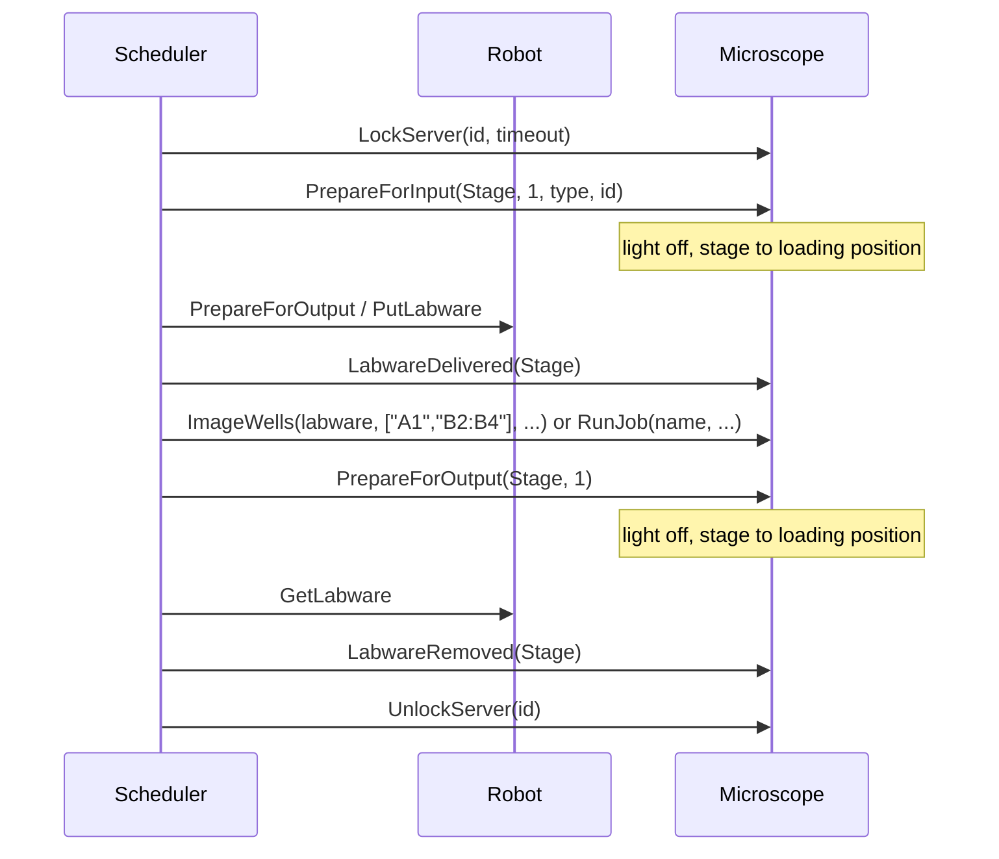

# SiLA 2 server (lab-automation workcells)

ImSwitch serves the microscope as a [SiLA 2](https://sila-standard.com) device. In a
lab-automation workcell (for example UniteLabs) the microscope is one station among an incubator,
a plate hotel, a liquid handler and a robot arm; the workcell's scheduler runs the workflow and
calls the microscope's functions as steps. The server is built on the UniteLabs connector kit
(`unitelabs-cdk`); the code is `SiLa2Manager` (server lifecycle), `SiLa2Controller` with
`controllers/sila2/features.py` (what the server offers) and `model/workcell_lock.py` (the lock
against the UI). Background and diagrams for users: openUC2 docs, Development → Software →
Lab automation (SiLA 2).

## Role in a workcell

The microscope is a passive device: it does not plan, it exposes functions. The scheduler
decides when a plate arrives, what is imaged and where the plate goes next. ImSwitch keeps what
only the instrument knows: its stage frame and travel limits, the taught plate origins and
loading position, its objectives, illumination and saved jobs, and its refusals.

| The workcell does | The microscope does |
|---|---|
| Plans the workflow, holds inventory and sample identity | Moves, focuses, illuminates, images |
| Moves plates with the robot | Hand-over side: light off, stage to the loading position |
| Locks the microscope for the duration of a workflow | Keeps the ImSwitch UI out while locked |
| Stores results in its data system | Writes OME-Zarr / OME-TIFF and returns the path |

## Enable it

Add `"SiLa2"` to `availableWidgets` and a `sila2` block to the setup JSON:

```json
"sila2": {
  "serverName": "FRAME 12",
  "serverPort": 50052,
  "discovery": true
}
```

| Key | Default | Meaning |
|---|---|---|
| `enabled` | `true` | Start the server |
| `serverName`, `serverDescription`, `serverVersion`, `vendorUrl` | | Reported by the SiLA Service feature |
| `serverHost` / `serverPort` | `0.0.0.0` / `50052` | Address the gRPC server binds to |
| `serverUUID` | derived | Unset: a UUID derived from host name and port, the same after every restart. Set it when a workcell must find the instrument after a host-name change |
| `discovery` | `true` | Announce over mDNS, so clients find the server by UUID or name |
| `tls`, `certificateChain`, `privateKey` | off | Serve over TLS; paths to (or PEM text of) the certificate chain and key |
| `cloudEndpoint`, `cloudPort` | none, `443` | UniteLabs cloud endpoint host name; unset = local network only |
| `handoverPositionName` | `Stage` | Name of the plate hand-over position |
| `plateOrigins` | `{}` | Written by SetPlateOrigin: labware load name → `[dx, dy]` µm |

The loading position is the positioner's `sampleLoadingPosition{X,Y,Z}` (device frame, µm),
taught with StageController/TeachLoadingPosition or `PositionerController/setSampleLoadingPosition`.

`GET /imswitch/api/SiLa2Controller/getSiLA2Status` reports whether the server runs, its UUID and
address, the last error, the lock, the plate on the stage (type and id as the robot announced
it) and the taught plate origins.

Network: the workcell needs to reach the port (gRPC over TCP) and, for discovery, mDNS
(UDP 5353 multicast). Guest Wi-Fi, VPNs and VLANs often block multicast; connect by address then.

Discovery announces, on each network interface, that interface's own address
(`DiscoveryConfig.network_interfaces` = all non-loopback IPv4 addresses). Without it the library
announced `127.0.0.1` for a server bound to `0.0.0.0`, and UniteLabs GroundControl on another
computer listed the FRAME as online (its probe falls back to the sender's address) but sent every
request to itself (`ECONNREFUSED 127.0.0.1:50052`). GroundControl keeps the connection and the
feature definitions it saw first: after an update, quit and reopen it.

GroundControl has no Swagger page. The browsable Swagger UI is the REST API of a UniteLabs
Platform tenant (cloud, or UniteLabs Desktop on premises), set up by UniteLabs; the FRAME shows up
there once it is connected to the tenant. ImSwitch's own HTTP API has Swagger at
`/imswitch/api/docs`.

## Features

All positions are µm in the ImSwitch user frame (the frame of `getPositionerPositions`), except
the loading position (device frame, like the setup). Every handler runs its ImSwitch call in a
worker thread and goes through the same controllers as the HTTP API, so stage travel limits and
the "something else is running" refusals apply. Refusals are defined execution errors a
scheduler can branch on.

| Feature | Elements |
|---|---|
| `org.openuc2/microscopy/StageController/v1` | Position, LivePosition (2 Hz), TravelLimits, LoadingPosition; MoveTo (XY), MoveFocusTo (Z), MoveBy, MoveToLoadingPosition, TeachLoadingPosition, Home (frame homing, observable), Stop |
| `org.openuc2/microscopy/ImagingController/v1` | Detectors (cameras that take images), IlluminationSources, Illumination (on/off, intensity, range, units, wavelength), ExposureTimes, Objectives, CurrentObjective; SnapImage (JPEG preview), SaveImage (OME-TIFF in `<data>/SiLA`), SetExposureTime, SetIllumination, SwitchOffIllumination, Autofocus, MoveToObjective (observable) |
| `org.openuc2/microscopy/ExperimentController/v1` | Labware, CalibratedLabware, ExperimentStatus, LastDataPath, ExperimentSchema; SetPlateOrigin, MoveToWell, ImageWells (observable), StartExperiment (any ImSwitch experiment as JSON), Pause/Resume/StopExperiment |
| `org.openuc2/microscopy/JobController/v1` | Jobs, JobStatus; RunJob (a saved Aufgaben job by name, observable), AbortJob |
| `org.silastandard/instruments.labware.transfer/LabwareTransferSiteController/v1` | AvailableHandoverPositions, NumberOfInternalPositions; PrepareForInput, LabwareDelivered, PrepareForOutput, LabwareRemoved |
| `org.silastandard/core/LockController/v2` | IsLocked; LockServer, UnlockServer |

Defined errors: `StageLimitReached`, `InstrumentBusy`, `UnknownDevice`, `NotAvailable`,
`PlateNotCalibrated`, `NotConfirmed`, `JobFailed`, `InvalidCommandSequence`, and the Lock
Controller's `ServerAlreadyLocked`, `ServerNotLocked`, `InvalidLockIdentifier`. Malformed input
(bad JSON parameters, an empty well list, an unknown handover or internal position, an intensity
out of range) is a SiLA validation error, raised before an observable command is accepted.
Moves, autofocus, objective changes and new scans are refused with `InstrumentBusy` while an
acquisition, job or calibration runs; ExperimentStatus and JobStatus are constrained to their
listed values.

RunJob is how a workflow step does anything the fixed commands do not: build the acquisition in
the ImSwitch Aufgaben app (loops over wells and positions, channels, autofocus, analysis), save
it, and call it by name with parameters as JSON. Jobs with ask-first steps (homing, objective
change) need `Confirmed`; a job that stops at an operator question fails with `JobFailed`.

### Plate hand-over

The microscope is the passive side of the SiLA labware-transfer pair; the robot implements
Labware Transfer Manipulator Controller.



PrepareForInput while a plate is on the stage, or LabwareDelivered without PrepareForInput,
fails with `InvalidCommandSequence`; an unknown handover position or an internal position other
than 1 is a validation error.

### Teaching (once per instrument and plate type)

1. Jog the stage (ImSwitch UI) to where the gripper can put a plate without touching the
   objective or condenser, then StageController/TeachLoadingPosition. Saved in the setup.
2. Put a plate of the type on the stage, centre a known well (e.g. A1) in the live view, then
   ExperimentController/SetPlateOrigin(Labware, Well). Saved per plate type in the setup;
   CalibratedLabware lists the taught types.

### Lock

The scheduler locks the microscope for a workflow with the SiLA standard Lock Controller
(LockServer with an identifier and a timeout in s; 0 = no timeout). While locked:

- The ImSwitch HTTP API, and with it the UI, may read and stop but not move, switch light or
  start acquisitions: those requests get **423 Locked**. Endpoints named `get…`, `is…`, `list…`,
  `stop…`, `cancel…`, `abort…` stay open, so an operator can always stop the instrument.
- Busy checks (Aufgaben, experiments, stage map, …) refuse to start from anywhere but SiLA.
- The timeout runs from the workcell's last call to the microscope.
- `POST /imswitch/api/SiLa2Controller/releaseWorkcellLock` frees the microscope by hand when a
  workcell crashed while holding it.

Between SiLA clients the lock is advisory: the SiLA framework makes lock metadata mandatory on
every covered call, even when unlocked, so the features are not covered and a second SiLA client
is not refused. In a workcell the scheduler is the only SiLA client.

## Checking an instrument: `imswitch-sila-check`

A SiLA client in the style of the
[UniteLabs client tutorial](https://docs.unitelabs.io/connector-development/tutorial/build-a-sila-client/)
that finds the server over mDNS (or takes host and port), reads every property, takes one value
from every observable property, calls every command and checks the refusals, including the core
SiLA Service (every feature definition) and Connection Configuration Service. Every element of
every feature is either run or listed as skipped; the exit code is 1 when one fails. It needs
only `unitelabs-sila` (`imswitch/sila_check.py`), so it runs on the workcell's computer too.

```bash
imswitch-sila-check --list
```

```bash
imswitch-sila-check --discover --name "FRAME 12"
```

```bash
imswitch-sila-check --host 192.168.1.42 --port 50052
```

```bash
imswitch-sila-check --discover --name "FRAME 12" --motion --light --intensity 10 --json report.json
```

| Flag | Adds |
|---|---|
| (none) | Properties, snaps, exposure, refusals, the lock, hand-over sequence checks that move nothing |
| `--motion` | Small relative moves (50 µm), move to the current position, loading position, MoveToWell, re-selecting the current objective, the hand-over sequence |
| `--light` | Illumination on at `--intensity` (default 0) |
| `--motion --light` | Autofocus (±20 µm), ImageWells (A1, A2), RunJob (`--job`, default `autofocus_here_macro`) |
| `--teach` | SetPlateOrigin (96-well plate, A1 at the current position) and TeachLoadingPosition: overwrites taught values; toggles the server-initiated connection mode and sets it back |
| `--home` | Homing (drives every axis to its end switch) |

On a real instrument run it without flags first; add `--motion` and `--light` only with the
stage free and nobody looking into the light path, `--teach` only on purpose.

CI runs it against the virtual microscope with everything except homing, plus a test that the
lock keeps HTTP moves out (`imswitch/imcontrol/_test/api/test_sila2.py`, step "SiLA 2 check" in
`test.yml`).

### A client built from the tutorial alone

On 2026-11-26 a fresh coding agent (no access to ImSwitch's code or docs) was given only the
tutorial and the running virtual server, with this brief:

> Build a test client that locates the SiLA server "Virtual FRAME" on the network by discovery,
> connects to it, and tests all of its endpoints, following
> https://docs.unitelabs.io/connector-development/tutorial/build-a-sila-client/. Treat the
> server as a black box: learn its features from GetFeatureDefinition. Read every property,
> take a value from every observable property, call every command, and provoke every declared
> error. Report coverage, failures, and everything in the feature definitions that made the
> client hard to write.

In about 30 minutes it covered all 85 elements of the 8 features and found 8 server faults,
all fixed and now tested by `imswitch-sila-check`: moves and autofocus were not refused during
a scan, a second scan gave an undefined error, bad JSON and an empty well list were not
validation errors, an internal position other than 1 was accepted, a timed-out lock was not
pushed to IsLocked subscribers, and the server-initiated connection mode failed (the connector
had no file to save it to; now `<config>/sila2_connections.json`). Its integrator complaints
added TravelLimits, LoadingPosition, Illumination and ExposureTimes, plainer descriptions, and
one-line logs for refusals (refusals took 0.1–0.3 s while a traceback was rendered, now 1 ms).
Repeat the run after larger changes.

### Extending it with an AI coding agent

The check is meant to grow with the features. To have an agent extend it, give it this page,
the client tutorial above and the running server:

> The SiLA server of this ImSwitch runs at `<host>:<port>`. Read `docs/SILA2.md`,
> `controllers/sila2/features.py` and `imswitch/sila_check.py`. Add steps to `sila_check.py` so
> every command and property is called, including the defined errors of the refusals, with
> motion, light and setup writes behind the existing flags. Run it against the virtual
> microscope until it passes, and report anything that looks like a server bug instead of
> changing the check to pass.

## Limits and open points

- The hand-over feature uses the identifier of the SiLA standard
  `LabwareTransferSiteController` (category `instruments.labware.transfer`, v1.0) with the
  structures the connector kit ships for the manipulator side; to be confirmed against the
  scheduler that drives it.
- The lock is advisory between SiLA clients (see Lock).
- Library notes for UniteLabs (unitelabs-sila 0.14 / cdk 0.18): `Client.discover()` drops its
  TLS arguments and has no timeout setting (the check uses `Discovery.wait_for`); the CDK's lock
  treats a 0 s timeout as expired and only notices expiry on the next read; lock metadata on a
  covered feature is required even when unlocked; the Connection Configuration Service needs a
  config file to save to.
- Discovery notes for UniteLabs: with no `network_interfaces`, a server on `0.0.0.0` announces
  `find_ip_addresses("0.0.0.0")`, which is `[<LAN>, "127.0.0.1"]` or only `127.0.0.1` when the host
  name does not resolve. GroundControl 1.39 stores the `127.0.0.1` A record; its online probe falls
  back to the sender's address, but a cached client does not, and two servers announcing
  `127.0.0.1:50052` share one entry in its address lookup.
- On an ESP32 stage `moveToSampleLoadingPosition` moves X, Y and Z in one command. Teach the
  loading position with Z at a safe height; an untaught position is the device origin (0, 0, 0),
  where homing ends.
- No plate-presence sensor: LabwareDelivered is taken on trust.
- Not tested on hardware yet; tested against the virtual microscope.
