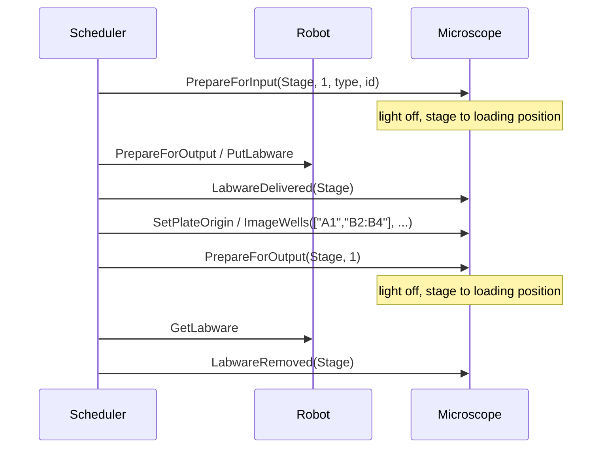

# SiLA 2 server (lab-automation workcells)

ImSwitch can serve the microscope as a [SiLA 2](https://sila-standard.com) device, so a workcell
scheduler (for example UniteLabs) can move the stage, take images, run well-plate scans and hand
plates over with a robot. The server is built on the UniteLabs connector kit
(`unitelabs-cdk`); the code is `SiLa2Manager` (server lifecycle) and `SiLa2Controller` with
`controllers/sila2/features.py` (what the server offers).

## Enable it

Add `"SiLa2"` to `availableWidgets` and a `sila2` block to the setup JSON:

```json
"sila2": {
  "serverName": "FRAME 12",
  "serverPort": 50052,
  "discovery": true
}
```

| Key | Default | Meaning |
|---|---|---|
| `enabled` | `true` | Start the server |
| `serverName`, `serverDescription`, `serverVersion`, `vendorUrl` | | Reported by the SiLA Service feature |
| `serverHost` / `serverPort` | `0.0.0.0` / `50052` | Address the gRPC server binds to |
| `serverUUID` | derived | Unset: a UUID derived from host name and port, the same after every restart. Set it when a workcell must find the instrument after a host-name change |
| `discovery` | `true` | Announce over mDNS, so clients find the server by UUID or name |
| `tls`, `certificateChain`, `privateKey` | off | Serve over TLS; paths to (or PEM text of) the certificate chain and key |
| `cloudEndpoint`, `cloudPort` | none, `443` | UniteLabs cloud endpoint host name; unset = local network only |
| `handoverPositionName` | `Stage` | Name of the plate hand-over position |

`GET /imswitch/api/SiLa2Controller/getSiLA2Status` reports whether the server runs, its UUID and
address, the last error and the plate on the stage (type and id as the robot announced it).

Network: the workcell needs to reach the port (gRPC over TCP) and, for discovery, mDNS
(UDP 5353 multicast). Guest Wi-Fi, VPNs and VLANs often block multicast; connect by address then.

## Features

All positions are µm in the ImSwitch user frame (the frame of `getPositionerPositions`).
Every handler runs its ImSwitch call in a worker thread and goes through the same controllers as
the HTTP API, so stage travel limits and the "something else is running" refusals apply.
Refusals are defined execution errors a scheduler can branch on.

| Feature | Elements |
|---|---|
| `org.openuc2/microscopy/StageController/v1` | Position, LivePosition (2 Hz); MoveTo (XY), MoveFocusTo (Z), MoveBy, MoveToLoadingPosition, Home (frame homing, observable), Stop |
| `org.openuc2/microscopy/ImagingController/v1` | Detectors, IlluminationSources; SnapImage (JPEG preview), SaveImage (OME-TIFF in `<data>/SiLA`), SetExposureTime, SetIllumination, SwitchOffIllumination, Autofocus (observable) |
| `org.openuc2/microscopy/ExperimentController/v1` | Labware, ExperimentStatus, LastDataPath, ExperimentSchema; SetPlateOrigin, MoveToWell, ImageWells (observable), StartExperiment (any ImSwitch experiment as JSON), Pause/Resume/StopExperiment |
| `org.silastandard/instruments.labware.transfer/LabwareTransferSiteController/v1` | AvailableHandoverPositions, NumberOfInternalPositions; PrepareForInput, LabwareDelivered, PrepareForOutput, LabwareRemoved |

Defined errors: `StageLimitReached`, `InstrumentBusy`, `UnknownDevice`, `NotAvailable`,
`PlateNotCalibrated`, `InvalidCommandSequence`.

### Plate hand-over

The microscope is the passive side of the SiLA labware-transfer pair; the robot implements
Labware Transfer Manipulator Controller.



PrepareForInput while a plate is on the stage, or LabwareDelivered without PrepareForInput,
fails with `InvalidCommandSequence`. The loading position is the setup's
`sampleLoadingPosition` (per axis); teach it so the gripper clears the objective and the
condenser.

### Demo flow (well plate)

1. `PrepareForInput` → robot puts the plate → `LabwareDelivered`.
2. Once per plate type and stage: centre the stage over a known well (jog in the ImSwitch UI,
   or `MoveTo`) and call `SetPlateOrigin(Labware, Well)`. Kept until ImSwitch restarts.
3. `ImageWells(["A1", "A2"], Illumination, Intensity, ExposureTime, Autofocus)` takes one image
   per well as an ImSwitch experiment (OME-Zarr) and returns the folder; the light is off
   afterwards. `SnapImage` returns a JPEG for a live view in the scheduler.
4. `PrepareForOutput` → robot takes the plate → `LabwareRemoved`.

## Checking an instrument: `imswitch-sila-check`

A SiLA client in the style of the
[UniteLabs client tutorial](https://docs.unitelabs.io/connector-development/tutorial/build-a-sila-client/)
that reads every property, takes one value from every observable property, calls every command
and checks the refusals. Every element of the four features is either run or listed as skipped;
the exit code is 1 when one fails.

```bash
imswitch-sila-check --host 192.168.1.42 --port 50052
```

```bash
imswitch-sila-check --discover --name "FRAME 12" --motion --light --intensity 10 --json report.json
```

| Flag | Adds |
|---|---|
| (none) | Properties, snaps, exposure, refusals, hand-over sequence checks that move nothing |
| `--motion` | Small relative moves (50 µm), move to the current position, loading position, MoveToWell, the hand-over sequence |
| `--light` | Illumination on at `--intensity` (default 0) |
| `--motion --light` | Autofocus (±20 µm) and ImageWells (A1, A2) |
| `--home` | Homing (drives every axis to its end switch) |

On a real instrument run it without flags first; add `--motion` and `--light` only with the
stage free and nobody looking into the light path.

CI runs it against the virtual microscope with everything except homing
(`imswitch/imcontrol/_test/api/test_sila2.py`, step "SiLA 2 check" in `test.yml`).

### Extending it with an AI coding agent

The check is meant to grow with the features. To have an agent extend it, give it this page,
the client tutorial above and the running server:

> The SiLA server of this ImSwitch runs at `<host>:<port>`. Read `docs/SILA2.md`,
> `controllers/sila2/features.py` and `controllers/sila2/check.py`. Add steps to `check.py` so
> every command and property is called, including the defined errors of the refusals, with
> motion and light behind the existing flags. Run it against the virtual microscope until it
> passes, and report anything that looks like a server bug instead of changing the check to
> pass.

## Limits and open points

- `SetPlateOrigin` is kept in memory only; a restart forgets it.
- The hand-over feature uses the identifier of the SiLA standard
  `LabwareTransferSiteController` (category `instruments.labware.transfer`, v1.0) with the
  structures the connector kit ships for the manipulator side; to be confirmed against the
  scheduler that drives it.
- No SiLA Lock Controller yet: nothing stops a person in the ImSwitch UI from moving the stage
  while a workcell runs a step. ImSwitch's own busy checks only cover acquisitions and jobs.
- Not tested on hardware yet; tested against the virtual microscope.
