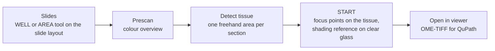

# Slide scanning (histology)

Whole-slide scanning of histology slides runs in the existing **WellPlate**
(Multi-dimensional acquisition) app and ExperimentController: no separate app.
What it adds is a tissue finder on the prescan, shading correction, and the
instrument's tested scan speed.

| Step | In the WellPlate app | Backend |
|---|---|---|
| Slides | Layout "4 Slide Heidstar"; select the slides with the WELL tool (or draw an AREA over them). | – |
| Prescan | PRESCAN sweeps the bounding box of the selection with the light as set in Live View. Colour cameras give colour strips. | `StageMapController.startPrescan` |
| Detect tissue | Button next to PRESCAN. Searches the slide slots the prescan covers; each tissue region becomes a freehand area (outline kept, re-tiled when the objective changes, with the run's tile overlap) with its autofocus points, and the focus map is switched on; the slide-wide selection and earlier tissue areas are replaced; pen marks are left out (colour prescans); the clear-glass spot becomes the shading reference and shading correction is switched on. Says so when no light is set under Channels. | `StageMapController.detectTissue` |
| Scan | START as usual. With the focus map on, the areas' own focus points are measured instead of a grid over their bounds (also in the plate-map preview). Output → *Shading Correction (flat-field)*. XY speed "This instrument" = `experiment.scanSpeedXY`. | `ExperimentController.startWellplateExperiment` |
| Results | One OME-Zarr (and stitched OME-TIFF) per section; *Open Vizarr*. Recent runs with their images: `getExperimentRuns`. | `ExperimentController` |

## Tissue detection (`imswitch/imcontrol/model/tissue_detection.py`)

The prescan strips are composed into one overview at 50 µm/px (each strip's
vignetting divided out by the median of the lit strips). Per slide rectangle:

1. **Glass**: the largest lit blob in the slot; the holder and the label are dark.
   A 2 mm band along the glass border, and a band along the slot's long sides
   (1.5 mm in colour, 3 mm in grey), never count as tissue.
2. **Tissue**: optical density against the glass level. In colour, tissue must be
   *stained* (H&E and IHC are coloured; glass edges, the coverslip rim, dust and
   refraction are grey). In grey, long thin lines parallel to the stage axes and
   bands right across the slide (coverslip end, label edge) are removed instead.
   **Pale parts** of a section (weak stain: OD ~0.03, little colour) look like
   glass with dust pixel by pixel. In colour they are followed from the stained
   parts: through areas that, on a ~1 mm median, absorb 0.008 more and are 0.004
   more coloured than the slide's glass, at most 6 mm from stain, never along ink.
   On a FRAME slide this turned two stained lobes with an unscanned 5 mm channel
   between them into one section (93 → 262 mm²); a smear elsewhere stays glass.
3. **Ink** (colour only): black (every channel below ~15 % transmission), green
   (green least absorbed, which no H&E stain does) or deep blue. Classified per
   pixel before pieces are formed, so a circle drawn around a section stays apart
   from it. Ink inside a section (margin dye, pigment, a dot on the tissue) is
   scanned with it and not reported. Grey prescans cannot tell ink from stain; the
   app says so.
4. **Regions**: pieces closer than 3 mm form one region, i.e. one image. Each gets
   a `scanPolygon` (the tissue grown by 400 µm plus 0.7 of a tile step, so the
   plate map's "field centre inside the polygon" tiling covers all of it), its own
   serpentine `tiles`, and 1–9 focus points spread over the tissue (farthest-point
   sampling, 600 µm inside its edge).
5. **Blank glass**: for the shading reference, the point farthest from tissue, ink
   and the border among those where the field (plus the reference grid) absorbs
   like the slide's glass in general (within 0.006 OD) and evenly (spread below
   0.012). A reference taken on a brighter patch of glass (0.012 below, 0.018
   across the field) put a 3–5 % left-right tilt into every tile of a FRAME scan;
   references on typical glass of two different slides agreed within 0.3 %.

The prescan keeps colour since this change: `_centreBand` used to keep channel 0
of an RGB frame only, and previews are now written RGB→BGR (red and blue were
swapped in stage-map tiles of colour cameras). Prescan strips are previewed at
`prescanPreviewUm` (25 µm/px) instead of 384 px per 27 mm line.

The camera lag (frames arrive tens of ms after exposure while the stage keeps
moving) is calibrated on the first line with contrast and then refined between
neighbouring lines (median of the last 7). A calibration can still lock onto the
wrong structure: on the FRAME it once matched one slide's edge to the next one's
(491 ms where 79–86 ms was right), and the lines placed before the neighbours
corrected it zig-zagged by ±9 mm. Each line is therefore kept at preview
resolution (block means, ~0.3 MB per line) and, when the prescan ends, every line
placed with a lag more than 5 ms from the settled one is laid out again under its
own tile id (`_placeAgain`).

## Shading correction (`imswitch/imcontrol/model/flatfield.py`)

A brightfield tile is darker towards its corners and differently so per colour
channel; stitched, that is a grid of darker seams with a colour cast. The
reference is blank glass:

- 9 fields on a 3×3 grid 150 µm apart around the glass spot (debris moves between
  them and drops out of the per-pixel median; vignetting and dust on the optics
  stay), plus one dark frame with the light off.
- Refused, with a reason an operator can act on, when saturated, too dark, or when
  more than 5 % of the field changes between the fields (tissue, a slide edge).
- Model per channel: `frame = dark + signal · F`, F = 1 at the brightest part of
  the field. Corrected: `dark + (frame − dark) / F`. The centre keeps its value,
  the corners are lifted to it; exposure and colour balance stay as set.
- Applied to the stitched image only (OME-Zarr canvas, stitched OME-TIFF, OMERO),
  per light (`illuminationChannel`). Individual tiles stay raw. The reference used
  is copied into the run folder (`flatfield_<light>/flatfield.ome.tif` + `.json`)
  and the protocol records `flat_field` (source, file, falloff), so the correction
  can be redone or undone.
- Stored per camera, objective, frame size, binning and light under
  `<config>/flatfield/<key>/`; a run without a glass spot uses the stored one.
- In a run, the fresh reference is taken with the first light that is on, at the
  run's exposure, gain and intensity. In a passthrough run (no light under
  Channels: the sample is lit by hand) no light is switched and there is no dark
  frame; the reference is taken under the light as it is.
- Measured on a FRAME scan (4x, HIK colour camera): raw glass tiles varied 12.7 %
  from centre to corner, corrected ones ±1 % (the rest was the spot problem above).
- About 30 ms per 6 MP RGB tile (OpenCV), in the writer thread.

API: `ExperimentController.captureFlatField` (POST; moves the stage, switches the
light), `getFlatFieldStatus`, `deleteFlatField(key)`; in a run
`parameterValue.flatField`, `flatFieldX/Y` (take a fresh reference there first),
`flatFieldFrames`, `flatFieldSpacingUm`.

## Scan speed

`experiment.scanSpeedXY` in the setup JSON is the instrument's tested XY speed
(stage units; UC2/ESP32: firmware steps/s, 80000 = 25 mm/s at 0.3125 µm/step).
Runs with `parameterValue.speed = 0` (the WellPlate default, shown as "This
instrument") use it; `getHardwareParameters` reports it as `scanSpeedXY`, and the
speed warnings in the WellPlate app only appear above it. Without the key it is
20000 as before.

## Autofocus light

Autofocus without a channel of its own (Z / Focus panel) looks through the run's
first light that is on, at the run's intensity for it, and leaves a passthrough
run's light alone. Before, the focus-map phase, which runs before any tile
switches a light on, focused on dark frames: on a FRAME slide scan every point
was rejected or a noise pick. Passthrough runs also no longer set their first
light to the sentinel power 1 at the start (it darkened a light set by hand).

Slides in one holder are not at one height. On the FRAME (4x, 2026-11-27) slide 3
fell by about 10 µm per mm along Y (above 7490 µm at its top section, below 7252 µm
at its bottom one) and slide 2 lay below 7291 µm. The first point of a region is
searched around the median of the points found so far, so every point of slide 2
(9) and of two slide 3 sections had its focus beyond the ±150 µm window; those
regions were scanned at one Z and came out visibly blurred, while the regions with
a fitted map were sharp. A focus-map point whose curve peaks at an edge of the
window is now searched once more, centred on that edge
(`_autofocus_following_edge`): Z goes at most twice the configured range away, and
a flat curve (no texture) is not followed.

## Untested / open

- Ink thresholds are set from synthetic data and the H&E stain vectors; they need
  checking on colour prescans of real pen marks (blue, black, green, red).
- Red ink is not classified (it is close to eosin).
- IHC with DAB (brown) counts as stained tissue; strongly blue counterstains near
  the blue-ink rule have not been tried.
- Pale-tissue growth is tuned on one H&E/DAB slide; very pale sections without any
  stained part are still missed, and a coloured smear touching a section would be
  followed (up to 6 mm).
- Tiles are placed at their stage positions without overlap blending; the
  WellPlate tile overlap defaults to 0.
