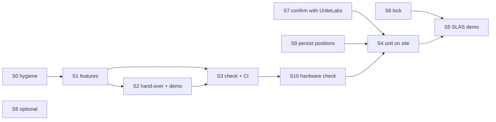

# UniteLabs / SiLA 2 integration — work packages (SLAS 2027)

Goal: a FRAME running ImSwitch joins a UniteLabs workcell as a plain SiLA 2 server. The
workcell plugs the microscope into its switch, finds it, and calls it from a workflow
(pick-and-place a plate onto the stage, image it, hand it back). The same unit runs at
SLAS 2027 in San Diego.

How to use what exists: [SILA2.md](SILA2.md). Reference:
[Build a SiLA client](https://docs.unitelabs.io/connector-development/tutorial/build-a-sila-client/).

## Starting point (2026-11-25)

- A CDK `Connector` in a daemon thread; three features with commands in two variants
  (plain and `_ul` with units); errors returned as `False` / `""`; blocking hardware calls on
  the SiLA event loop (a move stalled every other client).
- Hard-coded server UUID and UniteLabs dev cloud endpoint; `unitelabs-*` unpinned
  (installed: cdk 0.9 / sila 0.7, the tutorial needs sila >= 0.12).
- `sila.*` used at module level outside the import guard; widget key `SiLA2` vs `SiLa2`.

## Work packages

| WP | Title | Content | Status |
|---|---|---|---|
| S0 | Adapter hygiene | Stable UUID (host + port, or `serverUUID`); mDNS discovery; TLS; cloud endpoint from the setup; cdk 0.18 / sila 0.14 pinned; widget key; server reported running while the cloud connection retries | Done (virtual) |
| S1 | Features in CDK style | Stage, Imaging, Experiment features rewritten: one variant per command, µm / ms units, defined errors (StageLimitReached, InstrumentBusy, UnknownDevice, NotAvailable, PlateNotCalibrated), calls in worker threads through the controllers (travel limits, busy checks), observable Home / Autofocus / ImageWells | Done (virtual) |
| S2 | Hand-over + demo functions | SiLA standard `LabwareTransferSiteController` (passive side: light off, stage to loading position, sequence checks); `SetPlateOrigin`, `MoveToWell`, `ImageWells`, `SnapImage` (JPEG), `SaveImage` (OME-TIFF), `SwitchOffIllumination`, `Autofocus` | Done (virtual) |
| S3 | Check client + CI | `imswitch-sila-check`: every property and command, refusals, motion / light / homing behind flags, JSON report; pytest against the virtual microscope in `test.yml` | Done (virtual) |
| S4 | Unit for UniteLabs | Current FRAME instead of the old demo device; setup with `sila2` block and a taught `sampleLoadingPosition` the gripper can reach; DHCP + fixed host name; image with the CDK. Hand over in person (1–2 h) or ship | Open |
| S5 | SLAS demo | Their workcell: plate incubator → FRAME → image → back, run by their scheduler. Our Innovation Avenue table. Contacts and booth material | Open |
| S6 | Optional | AI lab-automation hackathon in Munich; self-assess ImSwitch against the "AI-ready instrument interface" scorecard preprint | Decide |

Added while building S0–S3 (missing from the first plan):

| WP | Title | Content | Status |
|---|---|---|---|
| S7 | Confirm with UniteLabs | Which features their scheduler and operator UI call; the hand-over feature identifier (we use `org.silastandard/instruments.labware.transfer/LabwareTransferSiteController/v1`); cloud endpoint vs local network; TLS required or not; how a JPEG preview should be shaped for their UI | Open |
| S8 | Lock against the UI | SiLA Lock Controller (CDK ships one): while a workcell holds the lock, the ImSwitch UI and other clients cannot move the stage or switch light | Open |
| S9 | Persist plate origin and hand-over position | `SetPlateOrigin` is in memory only; teach `sampleLoadingPosition` and the plate origin from the UI and store them in the setup (writes the setup JSON: ask-first on instruments) | Open |
| S10 | Hardware run of the check | `imswitch-sila-check` without flags, then with `--motion --light`, then `--home`, on the FRAME that goes to UniteLabs; fix what it finds | Open |
| S11 | Quieter error logs | The CDK logs every refusal with a full rich traceback (also expected ones like ValidationError); log defined errors on one line | Open |

## Timeline

| When | What |
|---|---|
| Week 48 (now) | S0–S3 done on the virtual microscope; S7 questions out |
| Early December | S9, S10 on the FRAME; hand-over of the unit (S4) before the partner travels; after that, testing goes remote with `imswitch-sila-check` |
| Mid December – January | S8; S4 fixes from their side; S5 dry runs |
| SLAS 2027, San Diego | S5 |

## Out of scope

- An MCP server on the device. The partner's view: an LLM needs the workcell context
  (devices, inventory, scheduler), which lives one layer above the device; SiLA plus the
  existing HTTP API is the device layer.
- Changing ImSwitch's HTTP API for SiLA. The SiLA features call the controllers.
