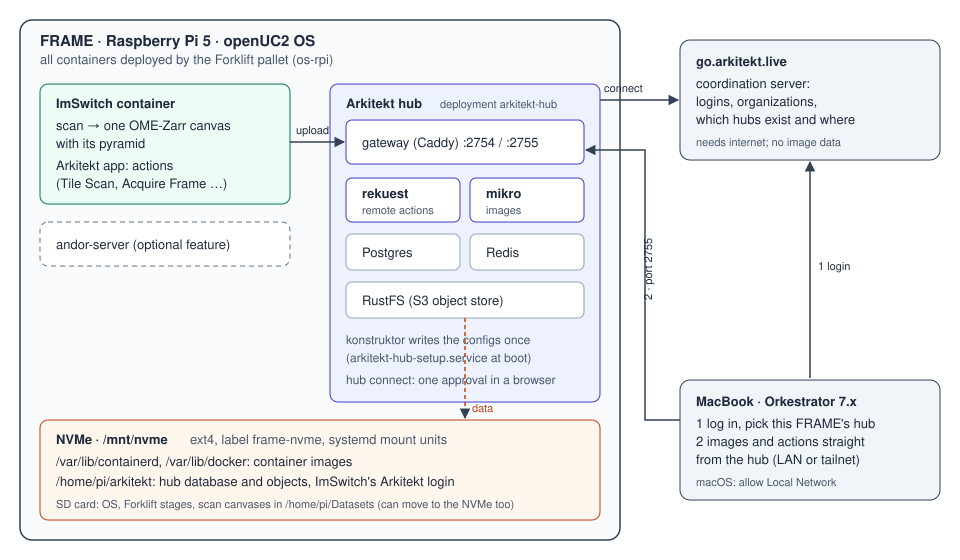

# Arkitekt hub on a FRAME

:::caution In progress
This is the working state of November 2026, not a released feature. It runs on one test FRAME.
The parts that are not merged yet are listed under [Status](#status).
:::

## The idea

[Arkitekt](https://arkitekt.live) connects microscopes, analysis tools and people. A **hub** stores
the images (*mikro*) and passes on remote actions (*rekuest*). A **coordination server**
(go.arkitekt.live) only holds the user accounts, the organizations, and which hubs exist and where
to reach them. No image data goes through it.

Each FRAME runs **its own hub**, installed by the openUC2 OS pallet together with ImSwitch:

- **ImSwitch** connects to the hub as an Arkitekt app. It offers actions such as *Tile Scan* and
  *Acquire Frame*. After a scan it uploads the canvas (one OME-Zarr image with its pyramid) to mikro.
- **Orkestrator**, the Arkitekt desktop app, logs in at go.arkitekt.live and picks the FRAME's hub.
  Images and actions then come **straight from the FRAME**, over the local network or the tailnet.
- The hub's database, objects and container images live on an **NVMe**, not on the SD card.



## What you need

- A FRAME with a Raspberry Pi 5 on openUC2 OS, with internet access.
- An NVMe (or a USB SSD). The stack does not fit on a 32 GB SD card next to ImSwitch.
- An account on go.arkitekt.live that is a member of your organization.
- For viewing: Orkestrator 7.x, so far built for macOS on Apple silicon only.

## The flow at a glance

Three people-facing steps need a browser. Each one is a short code that is valid for a few minutes;
anyone signed in to the organization can approve it, on any computer.

| Step | Where it starts | What you approve | Stored where |
|---|---|---|---|
| 1. Connect the hub | ImSwitch → Arkitekt panel → *This machine's hub* → **Connect hub** | The hub joins your organization | The hub's folder on the FRAME |
| 2. Bind ImSwitch | ImSwitch → Arkitekt panel → **Bind microscope** | ImSwitch may act for you, on **this FRAME's hub** (preselected) | ImSwitch's login folder on the FRAME |
| 3. Open Orkestrator | Orkestrator on your computer | Your normal login | Orkestrator, on your computer |

Steps 1 and 2 happen once per FRAME, both in the same browser page. They survive reboots and
ImSwitch updates.

## Installation

### 1. Put container storage on the NVMe

Format the disk once (this erases it) and give it a label:

```sh
lsblk                                   # the NVMe shows up as nvme0n1
sudo mkfs.ext4 -L frame-nvme /dev/nvme0n1
```

Mount it with systemd units. An `/etc/fstab` line does not work on openUC2 OS, because `/etc` is
an overlay that is mounted after systemd has read fstab.

```sh
sudo tee /etc/systemd/system/mnt-nvme.mount >/dev/null <<'EOF'
[Unit]
Description=FRAME NVMe (hub data and container storage)
[Mount]
What=/dev/disk/by-label/frame-nvme
Where=/mnt/nvme
Type=ext4
Options=defaults,noatime
EOF

bind() {  # unit name, mount point, folder on the NVMe
sudo tee /etc/systemd/system/$1.mount >/dev/null <<EOF
[Unit]
Requires=mnt-nvme.mount
After=mnt-nvme.mount
[Mount]
What=$3
Where=$2
Type=none
Options=bind
[Install]
WantedBy=multi-user.target
EOF
}
bind var-lib-containerd /var/lib/containerd /mnt/nvme/containerd
bind var-lib-docker     /var/lib/docker     /mnt/nvme/docker
bind home-pi-arkitekt   /home/pi/arkitekt   /mnt/nvme/arkitekt

# Docker and containerd start only once these are mounted, never on the SD card instead
for s in containerd docker; do
  sudo mkdir -p /etc/systemd/system/$s.service.d
  printf '[Unit]\nRequiresMountsFor=/var/lib/containerd /var/lib/docker /home/pi/arkitekt\n' |
    sudo tee /etc/systemd/system/$s.service.d/nvme.conf >/dev/null
done
sudo systemctl daemon-reload
```

Move the existing images over, then switch:

```sh
sudo systemctl start mnt-nvme.mount
sudo mkdir -p /mnt/nvme/{containerd,docker,arkitekt}
sudo systemctl stop docker.socket docker containerd
sudo rsync -aHAXS --numeric-ids /var/lib/containerd/ /mnt/nvme/containerd/
sudo rsync -aHAXS --numeric-ids /var/lib/docker/     /mnt/nvme/docker/
sudo mv /var/lib/containerd /var/lib/containerd.old && sudo mv /var/lib/docker /var/lib/docker.old
sudo mkdir -p /var/lib/containerd /var/lib/docker /home/pi/arkitekt
sudo systemctl enable --now var-lib-containerd.mount var-lib-docker.mount home-pi-arkitekt.mount
sudo systemctl start containerd docker.socket docker
sudo systemctl restart forklift-apply      # starts the containers again
findmnt -T /var/lib/docker                 # must show nvme0n1
sudo rm -rf /var/lib/containerd.old /var/lib/docker.old
```

Scan canvases stay in `/home/pi/Datasets` on the SD card unless you bind that folder to the NVMe
as well.

### 2. Enable the Arkitekt stack

The hub is a deployment of the pallet, off by default. Until it is merged, switch to its branch:

```sh
forklift plt switch github.com/openUC2/os-rpi@feat/arkitekt-hub
forklift plt enable-depl arkitekt-hub              # the hub
forklift plt enable-depl-feat imswitch arkitekt    # ImSwitch keeps its Arkitekt login
forklift plt stage                                 # downloads every image (about 3 GB more)
sudo reboot
```

`forklift plt switch` replaces the FRAME's local pallet. Re-enable deployments or features this
FRAME had and the branch lacks (for example `forklift plt enable-depl-feat imswitch andor-cameras`)
before `forklift plt stage`.

At boot, `arkitekt-hub-setup.service` creates the hub once in `/home/pi/arkitekt/arkitekt-hub`,
named like the FRAME (its hostname, e.g. `openuc2-separate-bath-30666`). Forklift then starts its
containers. Check:

```sh
journalctl -u arkitekt-hub-setup    # ends with "ready, not connected yet"
docker ps | grep arkitekt-hub       # eight containers; rekuest, mikro and the reporter wait
```

### 3. Turn on Arkitekt in ImSwitch

Add an `arkitekt` block to the ImSwitch setup file, and restart ImSwitch:

```json
"arkitekt": {"enabled": true, "appName": "frame-<name>", "url": "https://go.arkitekt.live",
             "autoConnect": true, "useMikro": true,
             "uploadExperiments": true, "deleteAfterUpload": false}
```

Open the **Arkitekt** panel (System; switch it on in the App Manager first). With the hub enabled,
it starts with a card *This machine's hub*.

### 4. Connect the hub (approval 1)

In the card, press **Connect hub to go.arkitekt.live**. After a few seconds it shows a code and an
**Accept the hub** button. Open it on any computer, sign in at go.arkitekt.live and accept the hub
into your organization. The code is valid for about ten minutes. The card then shows *Accepted, its
services restart…* for a minute or two, and finally *Connected*, with the hub's name, organization,
addresses and services. The organization lists the hub under the name given when it was accepted;
the card shows that name.

The hub advertises the addresses the FRAME has at that moment: LAN, hotspot, tailnet and
`<hostname>.local`. If they change, press **Connect again** in the card, or reserve the FRAME's
DHCP lease.

Without ImSwitch, the same works on the FRAME as `pi` (over SSH, or in the terminal of the FRAME's
admin page at `http://<frame>/admin/cockpit`): `arkitekt-hub-connect` prints the link and waits.

### 5. Bind ImSwitch (approval 2)

In the panel's *Connection*, press **Bind microscope**. It shows a code and a link, valid for
about five minutes; ImSwitch offers a fresh one for half an hour. The approval page **preselects
this FRAME's hub**: keep it, and approve. The panel shows *connected*, the hub card says *The
microscope uses this hub*, and the actions (Tile Scan, Acquire Frame …) appear in Orkestrator.

ImSwitch uses the hub chosen at this approval until you unbind it. If the card warns that the
microscope is bound to another hub, **Unbind** and bind again.

### 6. Open it in Orkestrator (approval 3)

Log in at go.arkitekt.live in Orkestrator and pick the FRAME's hub. On macOS, allow Orkestrator
under *Settings → Privacy & Security → Local Network*. From that computer this must print `200`:

```sh
curl -k -s -o /dev/null -w '%{http_code}\n' https://<frame address>:2755/mikro/ht
```

## Logins and secrets

Nothing on the FRAME holds a user's password. Accounts and organizations live on go.arkitekt.live;
the FRAME keeps tokens that were issued by approval, and keys it generated itself.

| What | Where (on the FRAME) | Made by | Who can read it |
|---|---|---|---|
| Database password, object-store keys | `/home/pi/arkitekt/arkitekt-hub/secrets/`, `docker-compose.yaml` | `konstruktor hub create`, at the first boot | `pi` only (folder 700, files 600); the containers read them as files |
| The gateway's TLS key and certificate | `…/arkitekt-hub/configs/gateway/hub.key`, `hub.crt` | `konstruktor hub create` | key: `pi` only |
| The hub's token at go.arkitekt.live | `…/arkitekt-hub/hub_credentials.json`, `hub_config.yaml` | approval 1 | `pi` only |
| The services' configs (tokens, keys) | `…/arkitekt-hub/configs/*.yaml` | approval 1 | `pi` only |
| ImSwitch's login | `/home/pi/arkitekt/imswitch/` (in the container: `~/.local/state/arkitekt`) | approval 2 | `pi` only (700) |
| `mandateKey` (optional, unattended login without a browser) | the ImSwitch setup file | a member, on go.arkitekt.live | whoever can read the setup file: keep it out of shared setups |
| The hub's state, for the panel (name, organization, addresses, the pending approval link) | `/home/pi/arkitekt/status/hub.json` | `arkitekt-hub-connect` | everyone: it holds nothing secret |

**How the panel connects the hub.** ImSwitch cannot run `konstruktor` itself: the hub's files
belong to the host. It asks the host's systemd, over the system D-Bus, to start
`arkitekt-hub-connect@<server>.service`, which runs as `pi` on the host and writes the state file.
A polkit rule of the hub deployment (`20-arkitekt-hub.rules`) lets user `pi` start and stop only
that unit, and start `arkitekt-hub-status.service` (a refresh of the state); every other unit is
refused. The ImSwitch container gets the D-Bus socket and the state folder (read-only) from the
`arkitekt` feature of the `imswitch` deployment.

The hub's certificate is self-signed (`CN=Arkitekt hub`). It is registered with go.arkitekt.live
when the hub connects, and Arkitekt clients accept only that certificate for that hub. So a
certificate error usually means that a client reached a **different hub** at that address, not that
the connection is attacked.

### Revoking and resetting

- **ImSwitch:** *Unbind* in the Arkitekt panel disconnects, revokes the session on the server and
  deletes the stored login. Binding again needs approval 2.
- **The hub:** remove it from the organization on go.arkitekt.live. To start over with a new hub,
  stop it and delete its folder; the next boot creates a new one. **This deletes every image stored
  in it.**
  ```sh
  konstruktor down --in /home/pi/arkitekt/arkitekt-hub
  sudo rm -rf /home/pi/arkitekt/arkitekt-hub && sudo reboot
  ```

## Troubleshooting

| You see | Meaning |
|---|---|
| ImSwitch or Orkestrator: *Could not resolve all required services … timed out* | The chosen hub is not reachable: the other FRAME is off, or not on your network. Unbind and choose this FRAME's hub. |
| *certificate verify failed: self-signed certificate* | The address answered with a certificate other than the registered one. Either it is another hub (the hotspot address `192.168.4.1` is the same on every FRAME: choose the right hub), or the hub was connected a moment ago and its gateway still serves the old certificate: wait until the hub card says *Connected*, then press **Connect** again. |
| Orkestrator: *Service mikro not found* | The computer does not reach the FRAME: check the Local Network permission and the `curl` above. |
| Services not ready right after approval 1 | The hub restarts its services; give it a minute, until the hub card says *Connected* (`konstruktor status --in /home/pi/arkitekt/arkitekt-hub` shows 8/8 running). |
| Hub card: *Not allowed to start arkitekt-hub-connect@…* | The hub deployment's polkit rule is not active yet: reboot after enabling the deployment. |
| Hub card: *ImSwitch cannot reach this machine's D-Bus* | Enable the `arkitekt` feature of the `imswitch` deployment, stage and reboot. |
| `systemctl status forklift-apply` failed | `journalctl -u forklift-apply -b`. Until a stage applies, the next boot falls back to the last stage that did. |
| Every new ImSwitch container asks to approve again | The `arkitekt` feature of the `imswitch` deployment is not enabled. |

Apply a staged pallet by hand with the system's stage store; `sudo -E` alone fails to record it:

```sh
sudo env FORKLIFT_STAGE_STORE=/var/lib/forklift/stages forklift stage apply
```

## Measurements

Synthetic scan, 10 × 10 RGB tiles of 3072 × 2048 pixels, 12 bit (3.8 GB raw), written with
ImSwitch's own OME-Zarr writer, then its pyramid. Same ImSwitch image, Raspberry Pi 5 with 8 GB.

| Step | NVMe | SD card |
|---|---|---|
| Write the 100 tiles | 83 s | 418 s |
| Build the pyramid (5 levels) | 35 s | 546 s |
| Total, including flushing to disk | **127 s** | **977 s** |
| CPU time spent waiting for the disk | 1 % | 69 % |

Then the same canvas (2.7 GB on disk with its pyramid) went into mikro on the FRAME's own hub,
everything on the NVMe. ImSwitch uploaded it from its upload queue, as after an experiment:

| | NVMe, this FRAME | SD card, FRAME ID10 |
|---|---|---|
| Upload into mikro | **170 s** | 259 s |
| End of the scan to the image in mikro (pyramid + upload) | **about 5 minutes** | 6.5 minutes |
| CPU while uploading | 80 % busy, 1 % waiting for the disk | 38 % waiting for the disk |
| Stored by mikro | 2.5 GB | |

With the NVMe the disk is no longer the limit. The upload keeps the four cores busy, because
mikro re-encodes every level. Memory available stayed near 3 GB, and the Pi did not throttle.

SD cards differ a lot: on FRAME ID10 the same pyramid took 128 s on its card, on this FRAME's
card 546 s.

## Known limits

- **Every scan is stored twice**, as ImSwitch's canvas and as mikro's re-encoded copy, unless
  `deleteAfterUpload` is on. mikro does not downscale on the server, so ImSwitch uploads its pyramid.
- **Orkestrator** draws at most 64 layers, so a scan has to be one canvas, not one image per tile.
- **Forklift removes compose projects it does not know.** Start the hub only through the pallet
  deployment, never with `konstruktor up`.
- Logins and token refresh need go.arkitekt.live, so the FRAME needs internet. A local coordination
  server (`konstruktor coord create`) would work offline but has not been tried.
- Docker publishes ports 2754 and 2755 on every interface, whatever the firewall zones say.

## Status

| | State |
|---|---|
| Pallet | os-rpi branch `feat/arkitekt-hub`, package `deployments/arkitekt-hub.pkg`; up to date with `edge`, no PR yet |
| ImSwitch | branch `feat/arkitekt-hub-mikro`, PR #333; the pallet pins its image `sha-3ef0c15` until it is merged |
| NVMe setup | manual (above); not yet a pallet deployment |
| Connecting without a terminal | the *This machine's hub* card in ImSwitch's Arkitekt panel; needs the os-rpi branch and an ImSwitch image built from `feat/arkitekt-hub-mikro` after PR #333's latest commits |
