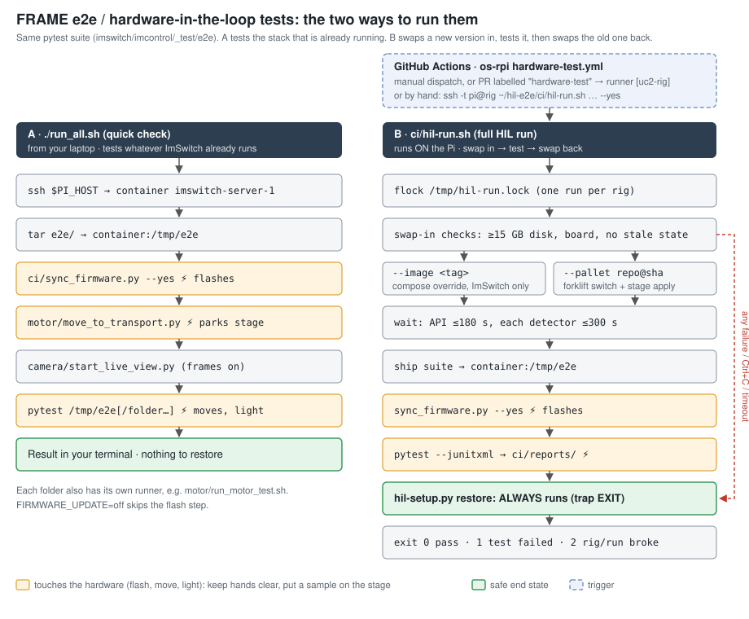

# Quickstart: FRAME e2e / HIL tests

**TL;DR:** This folder is a `pytest` suite that tests a real FRAME (Pi, UC2 boards, cameras, motors, LEDs) through the ImSwitch HTTP API. You can run it in two ways:

- **`./run_all.sh`** from your laptop checks the software the rig *already runs*. Start here.
- **`ci/hil-run.sh`** on the Pi (or from GitHub Actions) swaps in a *new* ImSwitch image or a whole `os-rpi` commit, runs the suite, and always swaps  the old version back.



> ⚠️ Both paths **flash firmware, move the stage and switch light on**. Keep
> hands off the rig, and put a sample with visible structure on the stage > (a central slot is best). Without one, the motor-camera tests skip. 

For the details, see [README.md](README.md) (the suite), [ci/README.md](ci/README.md)
(the HIL runner) and the README in each test folder (what each test checks and
which knobs it takes).

---

## What each folder tests

| Folder | Checks | Actuates |
|---|---|---|
| `board/` | the UC2 board is connected and runs the CANopen master firmware | – |
| `firmware/` | the firmware server has `.bin` files, and every board runs the server's `version.json` | sync **flashes** |
| `camera/` | every real detector returns a frame at the right resolution; the objective switch changes the image | objective **moves** |
| `lightsource/` | lasers and LEDs switch on and off; LED light reaches the camera | **light** |
| `ledmatrix/` | the LED matrix reaches the camera, compared against the camera noise | **light** |
| `motor/` | each axis moves and comes back; the observation camera sees it (phase correlation for X/Y, scale change for Z) | **moves** |

Missing hardware gives a **skip**, not a fail. The photon tests are the
exception: once they run, no light counts as a fail.

---

## Getting it working again (checklist)

Work top to bottom and stop at the first step that fails.

### 1. Find the rig

The CI rig is `pi@openuc2-separate-bath-30666`. The scripts hard-code
**different** default IPs (`run_all.sh` uses `.53`, the per-folder runners use
`.124`), and DHCP may have changed both. **Always set `PI_HOST`:**

```bash
export PI_HOST=pi@<pi-ip-or-hostname>
ssh $PI_HOST 'docker ps --format "{{.Names}}  {{.Image}}"'   # expect imswitch-server-1
curl -s http://<pi>:8000/imswitch/api/version              # ImSwitch answers?
```

If ImSwitch was just restarted, give it about 30 s. If you start too early,
every test **skips** (the run does not fail).

### 2. Smoke test (no flashing)

From the ImSwitch repo root:

```bash
cd imswitch/imcontrol/_test/e2e
FIRMWARE_UPDATE=off ./run_all.sh board        # 1–2 tests, fast
FIRMWARE_UPDATE=off ./run_all.sh camera
```

### 3. Full suite on what the rig runs

```bash
./run_all.sh                       # syncs firmware, parks the stage, runs everything
./run_all.sh lightsource ledmatrix # only some folders
MOTION_CAMERA_DISTANCE_UM=2000 ./run_all.sh motor   # with a test knob
```

Only variables with a known prefix (`PHOTON_`, `LEDMATRIX_`, `MOTION_CAMERA_`,
`TRANSPORT_`, `OBJECTIVE_`, `FIRMWARE_`, `AUTO_EXPOSURE_`, plus
`IMSWITCH_DETECTOR` and `UC2_LASER_VALUE`) are forwarded into the container. **A
typo is silently ignored**, and the test then runs with its default value.

### 4. Full HIL run by hand (on the Pi)

The Pi keeps a plain copy of the suite in `~/hil-e2e` (not a git checkout).
Refresh it, then run:

```bash
rsync -av --exclude __pycache__ --exclude .DS_Store --exclude ci/reports \
  ./ $PI_HOST:~/hil-e2e/
ssh -t $PI_HOST '~/hil-e2e/ci/hil-run.sh --image sha-<short-sha> --yes --tests "board camera"'
ssh -t $PI_HOST '~/hil-e2e/ci/hil-run.sh --pallet github.com/openUC2/os-rpi@<commit> --yes'
```

Use `-t`. Without it, Ctrl+C only kills your ssh client, and the Pi stays on
the swapped image. The JUnit report goes to `~/hil-e2e/ci/reports/`.

### 5. CI (GitHub Actions on `openUC2/os-rpi`)

The workflow is `.github/workflows/hardware-test.yml` on the os-rpi
**`hil-runner`** branch (not yet on `edge`). It runs on the self-hosted runner
with the label `uc2-rig`.

1. **Runner online?** Check
   <https://github.com/openUC2/os-rpi/actions/runners?tab=self-hosted>. On the Pi:
   ```bash
   cd ~/actions-runner-openuc2-os-rpi && sudo ./svc.sh status   # start | stop
   ```
   If `~/actions-runner-leonard-os-rpi` still exists, it belongs to Leo's fork.
   Stop and remove it (`sudo ./svc.sh uninstall`, then `./config.sh remove`).
2. **Where does the suite come from?** The workflow checks out the **default
   branch** of the `IMSWITCH_REPO` repo variable. If the variable is unset, it
   falls back to `LeonardPertsch/ImSwitch`. ⚠️ `openUC2/ImSwitch` `master` does
   **not** contain `e2e/` yet (it lives on `hil-runner`), so:
   - if you set `IMSWITCH_REPO=openUC2/ImSwitch` before the merge, run
     manually with `suite_ref=hil-runner`. PR-triggered runs cannot pass
     `suite_ref`, so they will fail.
   - if you keep the fallback, CI depends on Leo's fork staying alive.

   **Fix for good:** merge `hil-runner` into `openUC2/ImSwitch` master, then set
   `IMSWITCH_REPO=openUC2/ImSwitch` (os-rpi → Settings → Variables).
3. **Trigger:** Actions → *hardware-test* → *Run workflow* (optional inputs:
   `image`, `tests`, `suite_ref`). Alternatively, add the label
   `hardware-test` to a PR whose branch is in the same repo (PRs from forks
   never run on the rig).
4. **Result:** the job status follows the exit code (below). The JUnit XML is
   attached to the run as a `hil-report-*` artifact.

---

## Exit codes of `hil-run.sh`

| Code | Meaning | What to look at |
|---|---|---|
| `0` | all tests passed (skips are OK) | – |
| `1` | pytest ran, and a test failed or a folder name was misspelled | the JUnit report / log |
| `2` | the run could not happen: lock held, no `--yes`, < 15 GB free, no board, image pull failed, ImSwitch not up in 180 s, a detector with no frame in 300 s, the run was interrupted, **or the restore failed** | the rig, not the code |

---

## When the rig is stuck on a test version

This happens when a CI job was cancelled or the Pi lost power mid-run. A
leftover `/tmp/hil-state.json` means a swap was never undone, and every new
`swap-in` refuses to start until you restore:

```bash
ssh $PI_HOST 'python3 ~/hil-e2e/ci/hil-setup.py restore'
# or with the CI checkout:
ssh $PI_HOST 'python3 ~/actions-runner-openuc2-os-rpi/_work/os-rpi/os-rpi/ImSwitch/imswitch/imcontrol/_test/e2e/ci/hil-setup.py restore'
```

If that fails too, it prints the `docker compose` command to run by hand.

---

## Known flaky or limited parts

- **Empty CAN scan:** UC2-REST resends the scan after ~1 s, and the ~1.9 KB
  reply comes back truncated. The firmware tests fail on it, and the sync
  retries 3×. Re-run before you debug.
- **Firmware version tests skip** when ImSwitch lacks the update endpoints
  (openUC2/ImSwitch#324) or the firmware server has no `version.json`
  (youseetoo/uc2-esp32#133).
- **The firmware flash path is untested on the rig**: every board was already
  in sync whenever it ran.
- **Motor-camera tests** depend on room light, shadows and a structured
  sample. An unclear shift gives a skip. Only a motion in the *wrong* direction
  is a fail.
- **Restoring does not reflash.** After a `--pallet` run with a different
  firmware server, the boards keep the test version until the next sync.
- **Other services:** services that the test pallet does not contain are down
  during a `--pallet` run.
- **The lock covers `hil-run.sh` only.** A manual `run_all.sh` or a manual
  forklift change during a CI run is not blocked, and the restore may
  overwrite it.
